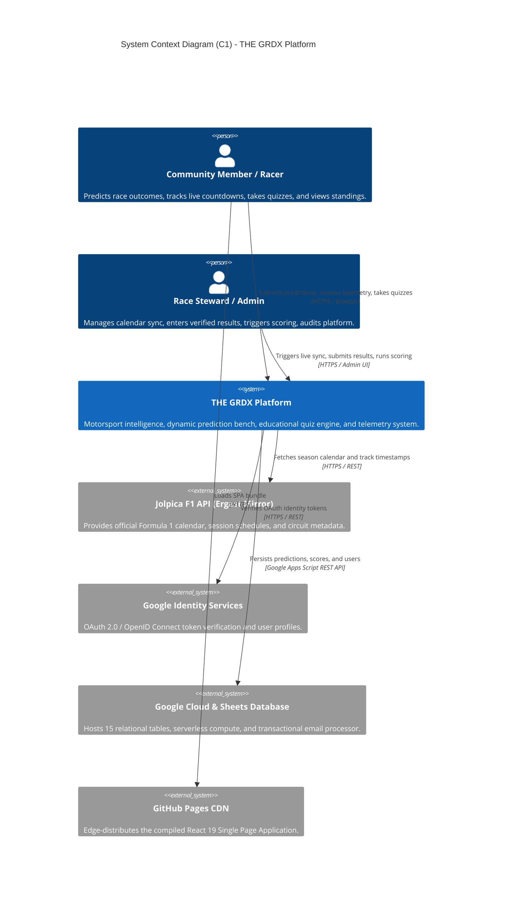
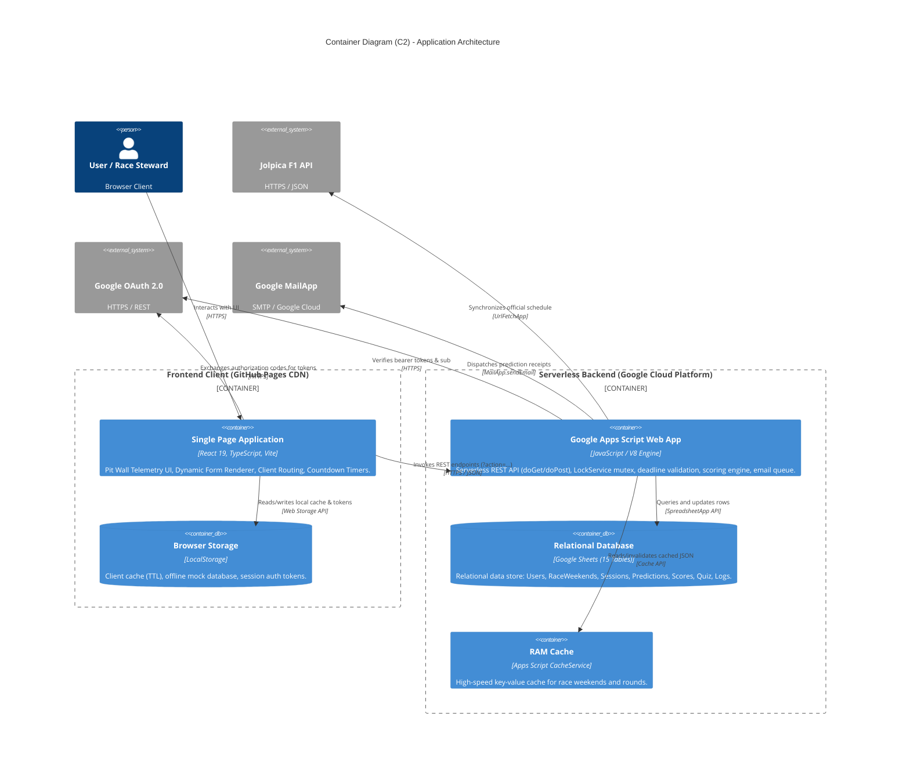
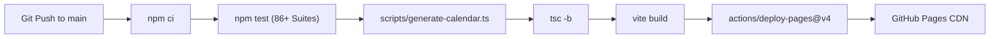

# 🏎️ THE GRDX — Formula 1 Prediction Wall & Motorsport Intelligence Platform

[](https://react.dev/)
[](https://www.typescriptlang.org/)
[](https://vitejs.dev/)
[-green.svg)](https://developers.google.com/apps-script)
[-34A853.svg)](https://sheets.google.com)
[](https://pages.github.com)
[](scripts/run-all-tests.js)
[](LICENSE)

An interactive, motorsport-inspired Formula 1 intelligence, learning, and prediction platform designed for racing communities. Users predict outcomes across all sessions of a Formula 1 weekend (Practice, Sprint Qualifying, Sprint Race, Qualifying, and Grand Prix), explore feeder series (F2, F3) and global disciplines (WEC, MotoGP, Indian Motorsport), test their knowledge via a 120-question quiz engine, and compete on three-tier session, weekend, and season championship leaderboards.

> 📖 **Full System Architecture & C1-C4 Diagrams**: For exhaustive technical diagrams, security specifications, complete 15-table relational data schemas, and sequence workflows, consult the [**Master Architecture Document (`docs/ARCHITECTURE.md`)**](docs/ARCHITECTURE.md).

---

## 🌐 Physical & Cloud Topology: Where Everything Lives

A key architectural strength of THE GRDX is its physical separation of concerns and 100% zero-cost cloud infrastructure:

```
┌─────────────────────────────────────────────────────────────────────────────────────────────┐
│                                 PHYSICAL & CLOUD TOPOLOGY                                   │
├────────────────────────────────┬──────────────────────────┬─────────────────────────────────┤
│          FRONTEND              │         BACKEND          │            DATABASE             │
├────────────────────────────────┼──────────────────────────┼─────────────────────────────────┤
│  Where it is:                  │  Where it is:            │  Where it is:                   │
│  • GitHub Pages Edge CDN       │  • Google Apps Script    │  • Google Sheets Relational     │
│  • Edge-distributed global CDN │    Web App               │    Cloud Database               │
│  • Static Single Page App      │  • Google Cloud Platform │  • Google Drive Cloud           │
│  • React 19 + TypeScript +     │    Serverless Engine     │  • 15 Relational Worksheets     │
│    Vite Bundle                 │  • V8 JavaScript Runtime │  • Automatic Revision History   │
│                                │  • Stateless HTTP REST   │                                 │
│  Live URL:                     │    Gateway               │  Live Sheet:                    │
│  https://hj1418.github.io/     │                          │  "F1 Prediction League          │
│  F1-Prediction-Wall/           │  Live Endpoint:          │   Database" (Google Drive)      │
│                                │  script.google.com/      │                                 │
│                                │  macros/s/.../exec       │  Cache & Fallback:              │
│                                │                          │  • Apps Script CacheService     │
│                                │                          │  • Browser LocalStorage Engine  │
└────────────────────────────────┴──────────────────────────┴─────────────────────────────────┘
```

1. **Where is the Frontend?**
   * Hosted on **GitHub Pages Edge CDN** (`https://hj1418.github.io/F1-Prediction-Wall/`).
   * Compiled as a high-performance, code-split static Single Page Application (SPA) using React 19, TypeScript, and Vite.
   * Cached globally at CDN edge nodes with HTTP/2 and HTTPS. Zero server maintenance, zero Node.js server overhead, and zero hosting costs.
2. **Where is the Backend?**
   * Hosted as a **Google Apps Script Web App** executing on **Google Cloud Platform** serverless infrastructure (`backend/Code.gs`).
   * Runs the modern V8 JavaScript engine.
   * Exposes stateless REST endpoints via `doGet(e)` and `doPost(e)` accepting JSON payloads.
   * Auto-scales on demand with zero idle computing costs.
3. **Where is the Database?**
   * Hosted in **Google Sheets** (`F1 Prediction League Database`) on **Google Drive / Google Cloud**.
   * Structured into **15 relational worksheets** (`Users`, `RaceWeekends`, `Sessions`, `PredictionRounds`, `Predictions`, `Results`, `Scores`, `Achievements`, `SyncLogs`, `NotificationQueue`, `NotificationLog`, `QuizCategories`, `QuizQuestions`, `QuizAttempts`, `QuizAchievements`).
   * ACID row-level locking provided by Google Apps Script `LockService`. 100% human-auditable by race stewards without requiring SQL administration tools.
   * Includes a built-in zero-config **offline `localStorage` fallback** (`src/services/mockApi.ts`) for instant portfolio evaluation.
4. **Where are External APIs?**
   * **Jolpica F1 Ergast API Mirror** (`https://api.jolpi.ca/ergast/f1/`): Ingests official Formula 1 calendar data, session schedules, and circuit metadata.
   * **Google Identity Services (GIS)** (`https://www.googleapis.com/oauth2/v3/userinfo`): Provides cryptographic OAuth 2.0 / OpenID Connect token verification.
   * **Google MailApp**: Transactional email delivery service executing within Google Cloud.

---

## 🌟 Key Features

### 1. Dynamic Prediction Bench & Session Rounds
* **Dynamic Weekend Format Detection:** Automatically identifies **NORMAL** vs. **SPRINT** formats by inspecting session types without fragile hardcoded weekend templates.
* **Granular Prediction Rounds:** Generates 2 rounds for Conventional Grands Prix (Qualifying + Race) and 4 rounds for Sprint weekends (Sprint Qualifying, Sprint Race, Qualifying, and Grand Prix).
* **Configurable Fields:** Dynamic driver pickers for Podium (P1, P2, P3), Fastest Lap, Driver of the Day, and Session Wildcards.
* **Mutual Exclusion:** Selecting a driver for P1 automatically disables them in P2 and P3 slots, preventing invalid podium combinations.
* **Dynamic Deadlines:** Predictions close strictly **5 minutes prior to each session's lights-out**, allowing users to adapt their strategy after watching Qualifying.

### 2. Multi-Championship & Feeder Series Intelligence
* **Formula 1:** Full 2026 driver grid, constructors, technical specs, and team personnel.
* **Feeder Series (F2 & F3):** Reverse grid algorithms (top 10 for F2, top 12 for F3), sprint/feature race points matrices, and pole position bonuses.
* **8 Junior Driver Academies:** Complete tracking for Ferrari Driver Academy, Red Bull Junior Team, Mercedes Junior Team, McLaren Driver Development, Alpine Academy, Williams Driver Academy, Sauber Academy, and Aston Martin Driver Development.
* **FIA Super Licence Matrix:** Interactive progression calculator tracking points required for Formula 1 eligibility (40 points over 3 seasons).
* **World Endurance Championship (WEC):** Hypercar and LMGT3 category tracking, endurance duration tiers (6h, 8h, 24h), and multi-tier points scales.
* **MotoGP:** Grand Prix and Sprint points, factory vs. satellite teams, and official manufacturer concession tiers (A, B, C, D).

### 3. Indian Motorsport Heritage Portal
* **Dedicated Heritage Hub:** Explores India's rich racing history and contemporary motorsport landscape.
* **Iconic Drivers:** Detailed career telemetry for Narain Karthikeyan, Karun Chandhok, Jehan Daruvala, Kush Maini, and Advait Deodhar.
* **Venues & Championships:** Buddh International Circuit (BIC), Madras Motor Race Track (MMRT), Kari Motor Speedway, Formula E Hyderabad E-Prix, MRF Challenge, and JK Tyre National Racing Championship.

### 4. Circuits Compendium & Interactive SVG Vectors
* **24 Championship Circuits:** Handcrafted, scalable vector track layouts with telemetry styling.
* **Technical Metadata:** Track length (km), official lap records, corner counts, DRS detection and activation zones, and elevation profiles.

### 5. Motorsport Fan Identity Quiz Engine
* **120 Verified Questions:** 15 curated questions per category across 8 motorsport categories (Formula 1, Formula 2, Formula 3, Formula 4, Formula E, MotoGP, Endurance Racing, GT Racing).
* **Fan Identity Tiering:** Evaluates responses and assigns a motorsport fan persona:
  * 🔰 *The Rookie* (<40%)
  * 🏎️ *The Enthusiast* (40-69%)
  * 🏁 *Paddock Insider* (70-89%)
  * 🏆 *Race Engineer / Motorsport Oracle* (90-100%)
* **Knowledge Badges:** Unlocks dedicated quiz badges (`first-lap`, `consistent-racer`, `podium-performance`, `motorsport-oracle`, `all-rounder`) kept strictly isolated from prediction league points.

### 6. Universal Command Search (`Cmd+K` / `Ctrl+K`)
* **Global Search Palette:** Accessible anywhere in the platform via `Cmd+K` (Mac) or `Ctrl+K` (Windows/Linux) or the navbar search icon.
* **Instant Multi-Entity Indexing:** Fast fuzzy searching across circuits, drivers, teams, championships, race weekends, and technical guides.

### 7. Three-Tier Leaderboards & Telemetry Profile
* **Three Levels of Standings:**
  1. *Session Leaderboard:* Individual session point breakdowns.
  2. *Weekend Championship:* Combined points across a Grand Prix weekend.
  3. *Season Championship:* Cumulative championship table with rank change deltas (`+2`, `-1`, `=`), crowns, and stats.
* **Racer Telemetry Profile:** Accuracy %, exact P1 count, perfect podium count, wildcard success rate, and achievement badges (*Bullseye*, *Strategy Master*, *On Fire*, *Consistency King*, *Ferrari Strategist*).

### 8. Admin Race Control Dashboard
* **Live Jolpica Calendar Sync:** One-click live sync from Jolpica F1 Ergast API with automatic schedule drift detection.
* **Official Results Entry:** Stewards input verified podiums, fastest laps, and wildcard outcomes.
* **Idempotent Scoring Engine:** Computes user points with 100% idempotency (scoring 250 predictions takes under 4ms at 63,700+ predictions/sec).
* **User Management & Audit Logs:** Steward tools to inspect user directories, review submission timestamps, and monitor `SyncLogs`.

---

## 📐 Architecture & C4 Model

### C1: System Context Diagram


### C2: Container Diagram


*(For C3 Component and C4 Code diagrams, see [docs/ARCHITECTURE.md](docs/ARCHITECTURE.md)).*

---

## 🛡️ Security Architecture & How Everything is Protected

Security is architected with defense-in-depth across the client, API gateway, and database layers:

1. **Authentication & Passwordless Identity Protection:**
   * User authentication relies exclusively on **Google Identity Services (GIS)** OAuth 2.0 / OpenID Connect.
   * No user passwords or password hashes are ever stored in the database, eliminating credential theft and database dump leaks.
   * Backend independently validates every token directly against Google's UserInfo API (`https://www.googleapis.com/oauth2/v3/userinfo`). Browser identity claims are never trusted.
   * The user's account is permanently bound to their immutable **Google Subject ID (`sub`)**, preventing email spoofing or account hijacking.
2. **Concurrency & Race Condition Defense (`LockService`):**
   * Critical mutations (user registration, score computation, notification sweeps) acquire a distributed mutex lock using Google Apps Script `LockService.getScriptLock()`.
   * Concurrent registrations or scoring runs resolve sequentially, preventing duplicate user accounts or multiplied points.
3. **Server-Controlled Deadline Verification & Anti-Cheat Engine:**
   * Client-side countdown timers are strictly cosmetic.
   * The backend independently compares the atomic server time (`new Date().getTime()`) against the round's `closesAt` timestamp. Submissions received after the deadline are rejected with `"Predictions are LOCKED"`.
4. **Podium Mutual Exclusion & Input Validation:**
   * Both client and server strictly validate that P1, P2, and P3 selections contain three distinct drivers (`Set(p1, p2, p3).size === 3`).
   * Inbound strings (usernames, driver slugs, answers) are sanitized and stripped of injection attacks.
5. **Role-Based Access Control (RBAC):**
   * User roles are stored in Column H of the database `Users` sheet. Client role claims in request payloads are discarded.
   * Steward actions (`adminSaveWeekend`, `adminSubmitResult`, `adminCalculateScores`, `getAdminUsers`) verify that the requester exists and has `role === 'admin'`. Non-admin requests fail with `403 Forbidden`.
6. **Anti-Spam & Delivery Isolation:**
   * Deterministic idempotency keys (`WELCOME_{userId}`, `PRED_{userId}_{roundId}`, `RESULT_{userId}_{roundId}`) guarantee zero duplicate emails.
   * Email delivery failures never roll back user predictions or score calculations.
7. **Network Resilience & Timeout Tolerance:**
   * The client API facade (`src/services/apiClient.ts`) wraps all requests in `fetchWithTimeout()` featuring an `AbortController` (25s timeout) and exponential retry backoff to handle Google Apps Script serverless cold-start latency.
8. **Data Privacy & Universal Auditor:**
   * Public leaderboards expose only handles and avatar initials, never private email addresses.
   * An automated database auditor (`auditPlatformData`) creates timestamped backup sheets before executing any batch data remediation.

---

## 🛠️ Technology Stack & Tradeoff Rationale

| Layer | Technologies | Rationale / Why Chosen |
| :--- | :--- | :--- |
| **Frontend Framework** | React 19, TypeScript 5.x, Vite 8.x | High-speed HMR (<50ms), route-level code splitting with `React.lazy`, strict compile-time typing across motorsport data models. Compiles to static files for zero-cost CDN hosting. |
| **Client Routing** | React Router v7 (`HashRouter`) | Deep-linking support compatible with GitHub Pages static hosting; paired with `public/404.html` redirect handling. |
| **Styling & Tokens** | Vanilla CSS, Design Tokens | Pure CSS variables with zero CSS-in-JS runtime overhead. Complete control over bespoke motorsport pit wall telemetry dark theme. |
| **Typography** | Google Fonts (`Outfit`, `JetBrains Mono`) | `JetBrains Mono` for monospace sector splits, lap times, and countdown clocks; `Outfit` for geometric UI typography. |
| **Icons & Effects** | `lucide-react`, `canvas-confetti` | High-contrast motorsport iconography and hardware-accelerated celebration animations on prediction lock. |
| **Serverless API** | Google Apps Script (V8 Engine) | Zero-cost serverless REST API executing inside Google Cloud. Zero server maintenance, automatic scaling, built-in `LockService`, `CacheService`, and `MailApp`. |
| **Cloud Database** | Google Sheets (15 Relational Worksheets) | Human-auditable by race stewards without SQL clients. Built-in revision history, automatic point-in-time recovery, and zero database hosting fees. |
| **F1 Data Integration** | Jolpica F1 Ergast API Mirror | Open-source, Ergast v1 backwards-compatible official calendar, session schedule, and circuit specification ingestion. |
| **Testing** | Node.js Test Suite (86+ Suites) | Automated testing of scoring math, Jolpica format detection, dynamic round synthesis, quiz bank integrity, and avatar invariants. |

---

## 📊 Scoring Rules Specification

The scoring engine implements strict motorsport scoring rules:
* **Exact P1:** `15 points`
* **Exact P2 / P3:** `10 points each`
* **Podium Driver in Wrong Position:** `5 points` (awarded if a driver finishes on the podium but in a different position than predicted)
* **🎯 Perfect 1-2-3 Podium Bonus:** `+10 points` (awarded only when P1, P2, and P3 are all exactly correct)
* **Fastest Lap:** `10 points`
* **Driver of the Day:** `10 points`
* **Session Wildcard:** `15 points`
* **Maximum Possible Single Session Score:** `80 points`

---

## ⚡ Quick Start (Local Development)

### 1. Clone & Install Dependencies
```bash
git clone https://github.com/Hj1418/F1-Prediction-Wall.git
cd F1-Prediction-Wall
npm install
```

### 2. Run Automated Test Suite
```bash
npm test
```
*Executes all test suites validating scoring math, idempotency, Jolpica format detection, dynamic round synthesis, quiz bank integrity, calendar subscriptions, and platform audit routines.*

### 3. Start Development Server
```bash
npm run dev
```
Open [http://localhost:5173](http://localhost:5173) in your browser.

*(If no `.env` is configured, the application automatically runs using the built-in offline mock engine with zero setup required).*

---

## ☁️ Google Apps Script Backend Deployment

1. Create a new Google Spreadsheet at [sheets.new](https://sheets.new) named: `F1 Prediction League Database`.
2. Open **Extensions > Apps Script**.
3. Copy [`backend/Code.gs`](backend/Code.gs) into the script editor.
4. Add [`backend/SetupSheet.gs`](backend/SetupSheet.gs) and run `initializeDatabase()`. This will automatically create, style, and header all 15 relational tables.
5. Click **Deploy > New deployment > Web app**:
   * **Execute as:** `Me`
   * **Who has access:** `Anyone`
6. Copy the **Web App URL** and add it to your `.env`:
   ```env
   VITE_API_URL=https://script.google.com/macros/s/AKfycb.../exec
   ```

---

## 🚢 CI/CD Deployment Flow to GitHub Pages

Every commit pushed to `main` triggers automated CI/CD via GitHub Actions ([`.github/workflows/deploy.yml`](.github/workflows/deploy.yml)):



**Live Production Site**: [https://hj1418.github.io/F1-Prediction-Wall/](https://hj1418.github.io/F1-Prediction-Wall/)

---

## 📜 License
MIT © 2026 Harsh Vardhan
