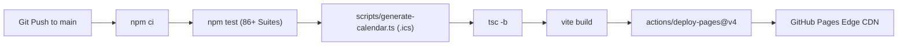

# 🏎️ THE GRDX — Formula 1 Prediction Wall & Motorsport Intelligence Platform

[](https://react.dev/)
[](https://www.typescriptlang.org/)
[](https://vitejs.dev/)
[-green.svg)](https://developers.google.com/apps-script)
[-34A853.svg)](https://sheets.google.com)
[](https://pages.github.com)
[-orange.svg)](public/calendar/the-grid.ics)
[](scripts/run-all-tests.js)
[](LICENSE)

An interactive, motorsport-inspired Formula 1 intelligence, learning, and prediction platform designed for racing communities. Users predict outcomes across all sessions of a Formula 1 weekend (Practice, Sprint Qualifying, Sprint Race, Qualifying, and Grand Prix), explore feeder series (F2, F3, F4) and global disciplines (WEC, MotoGP, GT Racing, Indian Motorsport), test their knowledge via a 120-question quiz engine, subscribe to live session calendar feeds, and compete on streamlined weekend and full-season championship leaderboards.

> 📖 **Full System Architecture & C1-C4 Diagrams**: For exhaustive technical diagrams, security specifications, complete 15-table relational data schemas, and sequence workflows, consult the [**Master Architecture Document (`docs/ARCHITECTURE.md`)**](docs/ARCHITECTURE.md).

---

## 🌐 Physical & Cloud Topology: Where Everything Lives

A key architectural strength of THE GRDX is its physical separation of concerns and 100% zero-cost cloud infrastructure:

```
┌─────────────────────────────────────────────────────────────────────────────────────────────┐
│                                 PHYSICAL & CLOUD TOPOLOGY                                   │
├────────────────────────────────┬──────────────────────────┬─────────────────────────────────┤
│          FRONTEND              │         BACKEND          │            DATABASE             │
├────────────────────────────────┼──────────────────────────┼─────────────────────────────────┤
│  Where it is:                  │  Where it is:            │  Where it is:                   │
│  • GitHub Pages Edge CDN       │  • Google Apps Script    │  • Google Sheets Relational     │
│  • Edge-distributed global CDN │    Web App               │    Cloud Database               │
│  • Static Single Page App      │  • Google Cloud Platform │  • Google Drive Cloud           │
│  • React 19 + TypeScript +     │    Serverless Engine     │  • 15 Relational Worksheets     │
│    Vite Bundle                 │  • V8 JavaScript Runtime │  • Automatic Revision History   │
│                                │  • Stateless HTTP REST   │                                 │
│  Live URL:                     │    Gateway               │  Live Sheet:                    │
│  https://hj1418.github.io/     │                          │  "F1 Prediction League          │
│  F1-Prediction-Wall/           │  Live Endpoint:          │   Database" (Google Drive)      │
│                                │  script.google.com/      │                                 │
│  Calendar Feed:                │  macros/s/.../exec       │  Cache & Fallback:              │
│  the-grid.ics (RFC 5545)       │                          │  • Apps Script CacheService     │
│                                │                          │  • Browser LocalStorage Engine  │
└────────────────────────────────┴──────────────────────────┴─────────────────────────────────┘
```

1. **Where is the Frontend?**
   * Hosted on **GitHub Pages Edge CDN** (`https://hj1418.github.io/F1-Prediction-Wall/`).
   * Compiled as a high-performance, code-split static Single Page Application (SPA) using React 19, TypeScript, and Vite.
   * Cached globally at CDN edge nodes with HTTP/2 and HTTPS. Zero server maintenance, zero Node.js server overhead, and zero hosting costs.
2. **Where is the Backend?**
   * Hosted as a **Google Apps Script Web App** executing on **Google Cloud Platform** serverless infrastructure (`backend/Code.gs`).
   * Runs the modern V8 JavaScript engine.
   * Exposes stateless REST endpoints via `doGet(e)` and `doPost(e)` accepting JSON payloads.
   * Auto-scales on demand with zero idle computing costs.
3. **Where is the Database?**
   * Hosted in **Google Sheets** (`F1 Prediction League Database`) on **Google Drive / Google Cloud**.
   * Structured into **15 relational worksheets** (`Users`, `RaceWeekends`, `Sessions`, `PredictionRounds`, `Predictions`, `Results`, `Scores`, `Achievements`, `SyncLogs`, `NotificationQueue`, `NotificationLog`, `QuizCategories`, `QuizQuestions`, `QuizAttempts`, `QuizAchievements`).
   * ACID row-level locking provided by Google Apps Script `LockService`. 100% human-auditable by race stewards without requiring SQL administration tools.
   * Includes a built-in zero-config **offline `localStorage` fallback** (`src/services/mockApi.ts`) for instant portfolio evaluation.
4. **Where are External APIs & Integrations?**
   * **Jolpica F1 Ergast API Mirror** (`https://api.jolpi.ca/ergast/f1/`): Ingests official Formula 1 calendar data, session schedules, and circuit metadata.
   * **Google Identity Services (GIS)** (`https://www.googleapis.com/oauth2/v3/userinfo`): Provides cryptographic OAuth 2.0 / OpenID Connect token verification.
   * **Google MailApp**: Transactional email delivery service executing within Google Cloud for prediction receipts, password reset links, and result digests.
   * **RFC 5545 iCalendar Feed**: Static `.ics` calendar feed generated at build time (`public/calendar/the-grid.ics`) for Google Calendar, Apple Calendar, and Outlook subscriptions.

---

## 🌟 Key Features & Systems

### 1. Dynamic Prediction Bench & Session Rounds
* **Dynamic Weekend Format Detection:** Automatically identifies **NORMAL** vs. **SPRINT** formats by inspecting session types without fragile hardcoded weekend templates.
* **Granular Prediction Rounds:** Generates 2 rounds for Conventional Grands Prix (Qualifying + Race) and 4 rounds for Sprint weekends (Sprint Qualifying, Sprint Race, Qualifying, and Grand Prix).
* **Mutual Exclusion Driver Selection:** Selecting a driver for P1 automatically disables them in P2 and P3 slots, preventing invalid podium combinations.
* **Dynamic Deadlines:** Predictions close strictly **5 minutes prior to each session's lights-out**, allowing users to adapt their strategy after watching Qualifying.
* **Interactive Points Breakdown Modal:** Inspect score chips for exact positions, podium bonuses, fastest laps, and wildcards.
* **Celebration Effects:** Confetti celebration bursts (`canvas-confetti`) trigger instantly upon locking predictions.

### 2. Streamlined Championship Leaderboards & Social Story Sharing
* **Two Unified Views:**
  1. *Season Championship:* Cumulative championship standings with rank change deltas (`+2`, `-1`, `=`), crowns, average points, and accuracy stats.
  2. *Weekend Championship:* Grand Prix standings with dynamic latest completed weekend resolution (`resolveLatestCompletedAndFinalizedWeekend`), session breakdowns, and Gold/Silver/Bronze weekend podium trophies.
* **9:16 Social Story Canvas Generator:** One-click export of visual story graphics formatted for Instagram, WhatsApp, and X/Twitter using HTML5 Canvas (`generateLeaderboardStoryCanvas` & `generateUserResultStoryCanvas`) with native Web Share API integration.
* **Full-Season Speedometer:** Real-time visual progress gauge tracking championship points milestones and full-season completion (`PredictionSpeedometer.tsx`).

### 3. Live In-App Notification Center & Modal Coordinator
* **Real-Time Notification Center:** Dropdown drawer with unread badges, timestamped alerts, and local storage state persistence (`NotificationCenter.tsx`).
* **Modal Coordinator:** Prevents notification modal collisions, sequencing alerts smoothly (`NotificationCoordinator.tsx`):
  * 🏆 **Weekend Trophy Modal:** Celebrates Gold, Silver, and Bronze weekend podium finishes with custom trophy visuals.
  * 🎖️ **Achievement Unlock Modal:** Celebrates newly earned platform badges (*Bullseye*, *Strategy Master*, *On Fire*, *Consistency King*, *Ferrari Strategist*).
  * 📊 **Points Breakdown Modal:** Displays comprehensive session point breakdowns.
  * 🔐 **Google Password Setup Modal:** Nudges OAuth racers to configure a native password for universal access.

### 4. Universal Public Calendar Subscription (.ics Feed)
* **RFC 5545 iCalendar Feed:** Automated build-time calendar generation (`scripts/generate-calendar.ts` -> `public/calendar/the-grid.ics`) compliant with RFC 5545 75-octet line folding and escaping.
* **One-Click Subscription:** Direct sync links for **Google Calendar**, **Apple Calendar** (`webcal://`), and **Microsoft Outlook**.
* **Local & IST Conversion:** Session timetables (FP1, FP2, FP3, Qualifying, Sprint, Race) automatically convert to the user's local timezone and Indian Standard Time (IST).
* **Today's Session Indicator:** Live visual badge highlighting races and sessions taking place today.

### 5. Motorsport Fan Identity Quiz Engine
* **120 Verified Questions:** 15 curated, fact-checked questions per category across 8 motorsport categories:
  * 🏎️ Formula 1
  * 🏁 Formula 2
  * 🚀 Formula 3
  * 🔰 Formula 4
  * ⚡ Formula E
  * 🏍️ MotoGP
  * ⏱️ World Endurance Championship (WEC)
  * 🚗 GT Racing
* **Auth-Gated Attempts:** Official quiz attempts require authenticated racer sessions to prevent leaderboard spam and preserve audit integrity.
* **Anti-Cheat & Ownership:** Attempts are bound to the user's account; correct answers and factual explanations are revealed only after submission.
* **Fan Identity Personas:** Evaluates performance and awards a persona tier:
  * 🔰 *The Rookie* (<40%)
  * 🏎️ *The Enthusiast* (40-69%)
  * 🏁 *Paddock Insider* (70-89%)
  * 🏆 *Race Engineer / Motorsport Oracle* (90-100%)
* **Knowledge Badges Registry:** 5 dedicated quiz badges (`first-lap`, `consistent-racer`, `podium-performance`, `motorsport-oracle`, `all-rounder`) kept strictly isolated from prediction league points.
* **Quiz History Ledger:** Racer profile includes a historical record of all completed quiz attempts, percentages, and persona tiers.

### 6. Where to Watch India & Heritage Portal
* **Broadcast Provider Separation:** Clear matrix distinguishing **FanCode** (live streaming) from **F1 TV Pro** (onboard cameras, telemetry, pit-lane channel) for Indian viewers.
* **Indian Motorsport Heritage Hub:** Dedicated portal celebrating India's racing history:
  * Iconic Drivers: Narain Karthikeyan, Karun Chandhok, Jehan Daruvala, Kush Maini, Advait Deodhar.
  * Historic Circuits: Buddh International Circuit (BIC), Madras Motor Race Track (MMRT), Kari Motor Speedway, Hyderabad E-Prix street circuit.
  * Championships: MRF Challenge, JK Tyre National Racing Championship.

### 7. Circuits Compendium & Interactive SVG Vectors
* **24 Championship Circuits:** Handcrafted, scalable vector track layouts with telemetry styling.
* **Technical Metadata:** Track length (km), official lap records, corner counts, DRS detection and activation zones, and elevation profiles.

### 8. Multi-Championship & Feeder Series Intelligence
* **Formula 1:** Full 2026 driver grid, constructors, technical specs, and team personnel.
* **Feeder Series (F2 & F3):** Reverse grid algorithms (top 10 for F2, top 12 for F3), sprint/feature race points matrices, and pole position bonuses.
* **8 Junior Driver Academies:** Complete tracking for Ferrari Driver Academy, Red Bull Junior Team, Mercedes Junior Team, McLaren Driver Development, Alpine Academy, Williams Driver Academy, Sauber Academy, and Aston Martin Driver Development.
* **FIA Super Licence Matrix:** Interactive progression calculator tracking points required for Formula 1 eligibility (40 points over 3 seasons).
* **World Endurance Championship (WEC):** Hypercar and LMGT3 category tracking, endurance duration tiers (6h, 8h, 24h), and multi-tier points scales.
* **MotoGP:** Grand Prix and Sprint points, factory vs. satellite teams, and official manufacturer concession tiers (A, B, C, D).

### 9. Brand Identity & Design System: THE GRDX
* **Bespoke Aerodynamic GRDX Logo:** Custom vector brand mark seamlessly blending an aerodynamic F1 car silhouette into the "X" of "GRDX" (`src/components/GrdxLogo.tsx`, `public/images/grdx-logo.svg`).
* **Telemetry Design System:** High-contrast pit-wall dark theme with race-red telemetry accents (`#E10600`), JetBrains Mono timing splits, and subtle glassmorphic surfaces.
* **Hero Section & Racing Tags:** Cinematic racetrack backdrop with interactive "Racing Tags" knowledge shortcuts and live session cards.
* **Telemetry Navigation:** Streamlined header with compact profile trigger, quick search, and dedicated "Compete" dropdown.

### 10. Universal Command Search (`Cmd+K` / `Ctrl+K`)
* **Global Search Palette:** Accessible anywhere via `Cmd+K` (Mac) or `Ctrl+K` (Windows/Linux) or the navbar search icon.
* **Instant Multi-Entity Indexing:** Fast fuzzy searching across circuits, drivers, teams, championships, race weekends, and technical guides.

### 11. Admin Race Control Dashboard
* **Live Jolpica Calendar Sync:** One-click live sync from Jolpica F1 Ergast API with automatic schedule drift detection.
* **Official Results Entry:** Stewards input verified podiums, fastest laps, and wildcard outcomes, with versioned amends (`version: 2`) and steward notes.
* **Idempotent Scoring Engine:** Computes user points with 100% idempotency, benchmarked at **69,600+ predictions/sec** (<4ms execution, 0 failure rate).
* **User Management & Audit Logs:** Steward tools to inspect user directories, review submission timestamps, and monitor `SyncLogs`.

---

## 🛡️ Security Architecture & Protection Systems

Security is architected with defense-in-depth across the client, API gateway, and database layers:

1. **Unified Dual-Authentication Engine:**
   * **Google Identity Services (GIS):** Passwordless OAuth 2.0 / OpenID Connect authentication. The backend independently verifies every token directly against Google's UserInfo API (`https://www.googleapis.com/oauth2/v3/userinfo`). Browser identity claims are never trusted. The account is permanently anchored to the user's immutable **Google Subject ID (`googleSubjectId`)**.
   * **Native Email & Salted SHA-256 Password Authentication:** Racers can register directly with email and password, or add a password to an existing Google OAuth account. Passwords are encrypted using cryptographically generated 32-character random salts and SHA-256 hashing via Google Apps Script `Utilities.computeDigest`.
   * **Self-Service Password Recovery:** Time-limited password reset tokens delivered securely via Google MailApp transactional emails (`requestPasswordReset` & `resetPassword`).
   * **Verified Admin Sessions:** Protected steward operations require backend-verified session tokens (`createAdminSessionToken`), preventing privilege spoofing.
2. **User Privacy & Racing Identity:**
   * Unique alphanumeric username validation (`checkUsernameAvailability`).
   * **Strict Leaderboard Privacy:** Private email addresses and Google Subject IDs are never exposed on public leaderboards or profile views. Standings display only handles and geometric avatar initials (`UserInitialsAvatar.tsx`).
3. **Concurrency & Race Condition Defense (`LockService`):**
   * Critical mutations (user registration, score computation, notification sweeps) acquire a distributed mutex lock using Google Apps Script `LockService.getScriptLock()`. Concurrent operations resolve sequentially, preventing duplicate accounts or multiplied points.
4. **Server-Controlled Deadline Verification & Anti-Cheat Engine:**
   * Client-side countdown timers are strictly cosmetic.
   * The backend independently compares the atomic server time (`new Date().getTime()`) against the round's `closesAt` timestamp. Submissions received after the deadline are rejected with `"Predictions are LOCKED"`.
5. **Podium Mutual Exclusion & Input Validation:**
   * Both client and server strictly validate that P1, P2, and P3 selections contain three distinct drivers (`Set(p1, p2, p3).size === 3`). Inbound strings are sanitized against injection attacks.
6. **Role-Based Access Control (RBAC):**
   * User roles are stored in Column H of the database `Users` sheet. Client role claims in request payloads are discarded. Steward actions verify that the requester exists and has `role === 'admin'`. Non-admin requests fail with `403 Forbidden`.
7. **Anti-Spam & Delivery Isolation:**
   * Deterministic idempotency keys (`WELCOME_{userId}`, `PRED_{userId}_{roundId}`, `RESULT_{userId}_{roundId}`) guarantee zero duplicate emails. Email delivery failures never roll back user predictions or score calculations.
8. **Network Resilience & Cold-Start Tolerance:**
   * The client API facade (`src/services/apiClient.ts`) wraps all requests in `fetchWithTimeout()` featuring an `AbortController` (25s timeout) and exponential retry backoff to gracefully handle serverless cold-start latency.
9. **Universal Platform Auditor:**
   * Automated audit routines (`auditPlatformData`, `auditAndDeduplicateUsers`) create timestamped backup sheets before executing any batch data remediation.

---

## 🛠️ Technology Stack & Tradeoff Rationale

| Layer | Technologies | Rationale / Why Chosen |
| :--- | :--- | :--- |
| **Frontend Framework** | React 19.2, TypeScript 5.x, Vite 8.x | High-speed HMR (<50ms), route-level code splitting with `React.lazy`, strict compile-time typing across motorsport data models. Compiles to static files for zero-cost CDN hosting. |
| **Client Routing** | React Router v7 (`HashRouter`) | Deep-linking support compatible with GitHub Pages static hosting; paired with `public/404.html` redirect handling. |
| **Styling & Tokens** | Vanilla CSS, Design Tokens | Pure CSS variables with zero CSS-in-JS runtime overhead. Bespoke motorsport pit wall dark telemetry theme (`#E10600` race-red accents, `#0B0E14` carbon background). |
| **Typography** | Google Fonts (`Outfit`, `JetBrains Mono`) | `JetBrains Mono` for monospace sector splits, lap times, and countdown clocks; `Outfit` for geometric UI typography. |
| **Icons & Effects** | `lucide-react`, `canvas-confetti` | High-contrast motorsport iconography and hardware-accelerated celebration animations on prediction lock. |
| **Social Story Canvas** | HTML5 Canvas API | Client-side 9:16 story card rendering (`generateLeaderboardStoryCanvas`, `generateUserResultStoryCanvas`) for Instagram, WhatsApp, and X/Twitter sharing. |
| **Serverless API** | Google Apps Script (V8 Engine) | Zero-cost serverless REST API executing inside Google Cloud. Zero server maintenance, automatic scaling, built-in `LockService`, `CacheService`, and `MailApp`. |
| **Cloud Database** | Google Sheets (15 Relational Worksheets) | Human-auditable by race stewards without SQL clients. Built-in revision history, automatic point-in-time recovery, and zero database hosting fees. |
| **Offline Simulation** | Browser `localStorage` Engine (`src/services/mockApi.ts`) | Zero-config offline mock database enabling immediate local testing and portfolio evaluation without cloud credentials. |
| **Calendar Engine** | RFC 5545 iCalendar Generator (`the-grid.ics`) | Automated build-time calendar generation with 75-octet line folding and timezone conversion for Google, Apple, and Outlook calendars. |
| **F1 Data Integration** | Jolpica F1 Ergast API Mirror | Open-source, Ergast v1 backwards-compatible official calendar, session schedule, and circuit specification ingestion. |
| **Testing** | Node.js Test Suite (86+ Suites) | Automated testing of scoring math, Jolpica format detection, dynamic round synthesis, quiz bank integrity, calendar subscriptions, and platform audit routines. |

---

## 📊 Scoring Rules Specification

The scoring engine implements strict motorsport scoring rules:
* **Exact P1:** `15 points`
* **Exact P2 / P3:** `10 points each`
* **Podium Driver in Wrong Position:** `5 points` (awarded if a driver finishes on the podium but in a different position than predicted)
* **🎯 Perfect 1-2-3 Podium Bonus:** `+10 points` (awarded only when P1, P2, and P3 are all exactly correct)
* **Fastest Lap:** `10 points`
* **Driver of the Day:** `10 points`
* **Session Wildcard:** `15 points`
* **Maximum Possible Single Session Score:** `80 points`
* **🏆 Weekend Trophies:** Top 3 community predictors of each Grand Prix weekend receive official Gold (1st), Silver (2nd), and Bronze (3rd) weekend trophies recorded in their racer profile.

---

## 🗄️ Relational Database Schema (15 Tables)

The cloud database is structured into 15 relational worksheets:

1. **`Users`**: User profiles, credentials (`passwordHash`), auth providers, statistics, and season points.
2. **`RaceWeekends`**: Grand Prix weekend calendar, dates, circuit references, and formats (`NORMAL` vs `SPRINT`).
3. **`Sessions`**: Individual sessions (FP1, FP2, FP3, Qualifying, Sprint, Race) with exact lights-out times.
4. **`PredictionRounds`**: Dynamic prediction rounds with field configurations and strict deadlines (5 mins before lights-out).
5. **`Predictions`**: Player prediction submissions with mutual exclusion driver selections.
6. **`Results`**: Verified official session outcomes submitted by Race Stewards with versioning (`version: 2`).
7. **`Scores`**: Calculated scores and category point breakdowns for each prediction.
8. **`Achievements`**: Earned platform trophies and prediction milestone badges.
9. **`SyncLogs`**: Audit log recording external calendar syncs and schedule drift detection.
10. **`NotificationQueue`**: Asynchronous message queue for transactional emails.
11. **`NotificationLog`**: Immutable archive of delivered or failed email notifications.
12. **`QuizCategories`**: The 8 motorsport knowledge disciplines and metadata.
13. **`QuizQuestions`**: 120 verified motorsport questions with explanations and sources.
14. **`QuizAttempts`**: User quiz attempts, scores, and assigned fan identity personas.
15. **`QuizAchievements`**: Unlocked motorsport knowledge badges.

---

## ⚡ Quick Start (Local Development)

### 1. Clone & Install Dependencies
```bash
git clone https://github.com/Hj1418/F1-Prediction-Wall.git
cd F1-Prediction-Wall
npm install
```

### 2. Available NPM Scripts
| Command | Description |
| :--- | :--- |
| `npm run dev` | Starts Vite development server at [http://localhost:5173](http://localhost:5173) (uses offline mock database if no `.env` is configured). |
| `npm test` | Executes all 86+ automated test suites, scoring benchmarks, and quiz bank integrity audits. |
| `npm run build:calendar` | Generates the static RFC 5545 `.ics` calendar feed in `public/calendar/the-grid.ics`. |
| `npm run build` | Generates calendar feed, runs TypeScript typecheck (`tsc -b`), and compiles the production Vite bundle. |
| `npm run lint` | Runs `oxlint` for high-speed static code analysis. |
| `npm run preview` | Previews the compiled production build locally. |

### 3. Start Development Server
```bash
npm run dev
```
Open [http://localhost:5173](http://localhost:5173) in your browser.

*(If no `.env` is configured, the application automatically runs using the built-in offline mock engine with zero setup required).*

---

## ☁️ Google Apps Script Backend Deployment

1. Create a new Google Spreadsheet at [sheets.new](https://sheets.new) named: `F1 Prediction League Database`.
2. Open **Extensions > Apps Script**.
3. Copy [`backend/Code.gs`](backend/Code.gs) into the script editor.
4. Add [`backend/SetupSheet.gs`](backend/SetupSheet.gs) and run `initializeDatabase()`. This will automatically create, style, and header all 15 relational tables.
5. Click **Deploy > New deployment > Web app**:
   * **Execute as:** `Me`
   * **Who has access:** `Anyone`
6. Copy the **Web App URL** and add it to your `.env`:
   ```env
   VITE_API_URL=https://script.google.com/macros/s/AKfycb.../exec
   VITE_GOOGLE_CLIENT_ID=your-google-oauth-client-id.apps.googleusercontent.com
   ```

---

## 🚢 CI/CD Deployment Flow to GitHub Pages

Every commit pushed to `main` triggers automated CI/CD via GitHub Actions ([`.github/workflows/deploy.yml`](.github/workflows/deploy.yml)):



**Live Production Site**: [https://hj1418.github.io/F1-Prediction-Wall/](https://hj1418.github.io/F1-Prediction-Wall/)

---

## 📂 Project Directory Structure

```
F1-Prediction-Wall/
├── .github/workflows/        # Automated GitHub Actions CI/CD deployment
├── backend/                  # Google Cloud Platform serverless backend
│   ├── Code.gs               # Core REST API, scoring engine & auth handlers (5,000+ lines)
│   └── SetupSheet.gs         # Database initialization for all 15 relational tables
├── docs/                     # Technical architecture documentation & C1-C4 diagrams
│   ├── ARCHITECTURE.md       # Master technical architecture & system specifications
│   └── SYSTEM_ARCHITECTURE.md# High-level architecture overview
├── public/                   # Static assets & calendar feeds
│   ├── calendar/the-grid.ics # RFC 5545 iCalendar feed
│   ├── images/               # Logos, hero images, circuit SVGs
│   └── 404.html              # SPA deep-link routing fallback
├── scripts/                  # Automated verification, benchmarks & generators
│   ├── run-all-tests.js      # Unified master test suite runner (86+ suites)
│   ├── generate-calendar.ts  # RFC 5545 iCalendar feed generator
│   ├── benchmark-scoring.ts  # High-throughput scoring performance benchmark
│   └── audit-quiz-questions.ts# Deep factual audit for 120-question bank
├── src/                      # Client-side React 19 application
│   ├── assets/               # Local icons and imagery
│   ├── components/           # Modular UI components
│   │   ├── auth/             # Login, Password Setup & Forgot Password modals
│   │   ├── common/           # Brand logos, avatars, footers, countdown timers
│   │   ├── navbar/           # Telemetry header, Compete dropdown, mobile drawer
│   │   ├── notifications/    # In-app notification center & celebration modals
│   │   ├── predictions/      # Prediction bench, speedometer, points breakdown
│   │   ├── quiz/             # Quiz question cards, category selectors, history
│   │   ├── search/           # Cmd+K universal search modal
│   │   └── sharing/          # HTML5 Canvas 9:16 social story cards
│   ├── context/              # React Context (AuthContext, AppContext)
│   ├── pages/                # Route pages (Home, Predict, Standings, Quiz, Calendar, Profile, Admin)
│   ├── services/             # API client, offline mock database, quiz registries
│   │   ├── quiz/             # Question bank, quiz service & achievement registry
│   │   └── sharing/          # Canvas story generation services
│   ├── types/                # TypeScript type definitions and data contracts
│   ├── utils/                # Race lifecycle, date formatting & scoring algorithms
│   ├── App.tsx               # Main application routing and notification layout
│   └── index.css             # Vanilla CSS telemetry design system and tokens
├── package.json              # Project dependencies & scripts
├── tsconfig.json             # TypeScript compiler configuration
└── vite.config.ts            # Vite bundler configuration
```

---

## 📜 License
MIT © 2026 Harsh Vardhan

