# 🏎️ THE GRDX (F1 Prediction Wall) — Master Technical Architecture & System Design Documentation

---

## 📑 Table of Contents
1. [Executive Summary & System Vision](#1-executive-summary--system-vision)
2. [Physical & Cloud Topology: Where Everything Lives](#2-physical--cloud-topology-where-everything-lives)
   - [2.1 Frontend Hosting (GitHub Pages)](#21-frontend-hosting-github-pages)
   - [2.2 Serverless Backend (Google Apps Script)](#22-serverless-backend-google-apps-script)
   - [2.3 Relational Cloud Database (Google Sheets)](#23-relational-cloud-database-google-sheets)
   - [2.4 External APIs & Identity Providers](#24-external-apis--identity-providers)
   - [2.5 High-Level Infrastructure Topology Diagram](#25-high-level-infrastructure-topology-diagram)
3. [Technology Stack & Architectural Rationale](#3-technology-stack--architectural-rationale)
   - [3.1 Technologies Selected](#31-technologies-selected)
   - [3.2 Why We Chose This Tech Stack (Deep Tradeoff Analysis)](#32-why-we-chose-this-tech-stack-deep-tradeoff-analysis)
4. [The C4 Architectural Model](#4-the-c4-architectural-model)
   - [4.1 Level 1: System Context Diagram (C1)](#41-level-1-system-context-diagram-c1)
   - [4.2 Level 2: Container Diagram (C2)](#42-level-2-container-diagram-c2)
   - [4.3 Level 3: Component Diagram (C3)](#43-level-3-component-diagram-c3)
   - [4.4 Level 4: Code-Level Class & Interface Diagram (C4)](#44-level-4-code-level-class--interface-diagram-c4)
5. [Database Schema & Relational Data Model (15 Tables)](#5-database-schema--relational-data-model-15-tables)
   - [5.1 Entity Relationship Diagram (ERD)](#51-entity-relationship-diagram-erd)
   - [5.2 Complete Table Dictionaries](#52-complete-table-dictionaries)
6. [Platform Security & Protection Architecture](#6-platform-security--protection-architecture)
   - [6.1 Authentication & Passwordless Identity Protection](#61-authentication--passwordless-identity-protection)
   - [6.2 Concurrency & Race Condition Defense (LockService)](#62-concurrency--race-condition-defense-lockservice)
   - [6.3 Server-Controlled Deadline Verification & Anti-Cheat Engine](#63-server-controlled-deadline-verification--anti-cheat-engine)
   - [6.4 Mutual Exclusion & Input Sanitization](#64-mutual-exclusion--input-sanitization)
   - [6.5 Role-Based Access Control (RBAC)](#65-role-based-access-control-rbac)
   - [6.6 Anti-Spam & Notification Protection](#66-anti-spam--notification-protection)
   - [6.7 Network Resilience, Timeout & Cold-Start Tolerance](#67-network-resilience-timeout--cold-start-tolerance)
   - [6.8 Data Privacy & Universal Platform Auditor](#68-data-privacy--universal-platform-auditor)
7. [Exhaustive Feature Directory](#7-exhaustive-feature-directory)
   - [7.1 Dynamic Prediction Bench & Session Rounds](#71-dynamic-prediction-bench--session-rounds)
   - [7.2 Race Calendar & Localized Chronological Timeline](#72-race-calendar--localized-chronological-timeline)
   - [7.3 Scoring Engine & Points Breakdown](#73-scoring-engine--points-breakdown)
   - [7.4 Three-Tier Leaderboards](#74-three-tier-leaderboards)
   - [7.5 Driver Profile, Telemetry & Achievement Badges](#75-driver-profile-telemetry--achievement-badges)
   - [7.6 Explore & Multi-Championship Hub (F1, F2, F3, WEC, MotoGP)](#76-explore--multi-championship-hub-f1-f2-f3-wec-motogp)
   - [7.7 Junior Driver Academies & Super Licence Progression](#77-junior-driver-academies--super-licence-progression)
   - [7.8 Indian Motorsport Portal](#78-indian-motorsport-portal)
   - [7.9 Circuits Compendium & Interactive SVG Vector Track Maps](#79-circuits-compendium--interactive-svg-vector-track-maps)
   - [7.10 Motorsport Learning Hub & Technical Regulation Guides](#710-motorsport-learning-hub--technical-regulation-guides)
   - [7.11 Motorsport Fan Identity Quiz Engine](#711-motorsport-fan-identity-quiz-engine)
   - [7.12 Universal Command Search (Cmd+K / Ctrl+K)](#712-universal-command-search-cmdk--ctrlk)
   - [7.13 Admin Race Control Dashboard](#713-admin-race-control-dashboard)
   - [7.14 Asynchronous Notification Queue & Email Dispatch](#714-asynchronous-notification-queue--email-dispatch)
   - [7.15 Dual-Backend & Offline Simulation Engine](#715-dual-backend--offline-simulation-engine)
8. [End-to-End System Workflows & Sequence Diagrams](#8-end-to-end-system-workflows--sequence-diagrams)
   - [Workflow 1: Google GIS Authentication & Onboarding](#workflow-1-google-gis-authentication--onboarding)
   - [Workflow 2: External Calendar Synchronization & Schedule Drift Detection](#workflow-2-external-calendar-synchronization--schedule-drift-detection)
   - [Workflow 3: Prediction Submission & Deadline Enforcement](#workflow-3-prediction-submission--deadline-enforcement)
   - [Workflow 4: Official Results Ingestion & Idempotent Scoring Pipeline](#workflow-4-official-results-ingestion--idempotent-scoring-pipeline)
   - [Workflow 5: Three-Tier Championship Leaderboard Aggregation](#workflow-5-three-tier-championship-leaderboard-aggregation)
   - [Workflow 6: Motorsport Quiz Attempt Lifecycle & Tier Assignment](#workflow-6-motorsport-quiz-attempt-lifecycle--tier-assignment)
   - [Workflow 7: Asynchronous Notification Queue & MailApp Delivery](#workflow-7-asynchronous-notification-queue--mailapp-delivery)
9. [Deployment Flow, Hosting & CI/CD Pipeline](#9-deployment-flow-hosting--cicd-pipeline)
   - [9.1 Continuous Integration & GitHub Actions Workflow](#91-continuous-integration--github-actions-workflow)
   - [9.2 Google Apps Script Production Deployment](#92-google-apps-script-production-deployment)
   - [9.3 SPA Routing & GitHub Pages 404 Fallback](#93-spa-routing--github-pages-404-fallback)
10. [Strategic Engineering Roadmap](#10-strategic-engineering-roadmap)

---

## 1. Executive Summary & System Vision

### 1.1 Product Vision: THE GRDX
**THE GRDX** (The Motorsport Starting Point, originally developed as *F1 Prediction Wall*) is a modern, high-performance web platform designed for racing fans, engineers, and gaming communities. It solves the key shortcomings of traditional motorsport fantasy and prediction products:
* **Rigid Single-Format Assumptions:** Most platforms fail when Formula 1 introduces Sprint formats, schedule adjustments, or rain delays. THE GRDX introduces a dynamic session round architecture that handles any racing session independently.
* **Single Friday Lockouts:** Locking all weekend predictions prior to Friday Practice 1 destroys engagement over the race weekend. THE GRDX dynamically locks each session **5 minutes prior to that specific session's lights-out**, allowing users to adapt their race strategy after observing Qualifying.
* **Opaque Scoring Formulas:** THE GRDX implements deterministic, open-source scoring mathematics with clear breakdowns (exact podium slots, correct drivers in wrong positions, fastest lap, driver of the day, session wildcard, and perfect 1-2-3 podium bonuses).
* **Costly Server Overhead:** Instead of maintaining expensive containerized microservices and Kubernetes clusters, THE GRDX runs on a **100% serverless, zero-maintenance, zero-cloud-bill stack**: GitHub Pages CDN for the frontend, Google Apps Script serverless V8 execution for backend logic, and Google Sheets as an auditable cloud relational database.
* **Multi-Discipline Motorsport Coverage:** The platform goes beyond Formula 1 by providing first-class coverage of Formula 2, Formula 3, Junior Driver Academies, FIA Super Licence points tracking, WEC Hypercar/LMGT3, MotoGP, Indian Motorsport, and a multi-category educational Quiz engine.

---

## 2. Physical & Cloud Topology: Where Everything Lives

A frequent point of confusion in modern web engineering is knowing exactly where each piece of the system physically executes and resides. Below is the precise physical and cloud mapping of THE GRDX platform.

```
┌─────────────────────────────────────────────────────────────────────────────────────────────┐
│                                 PHYSICAL & CLOUD TOPOLOGY                                   │
├────────────────────────────────┬──────────────────────────┬─────────────────────────────────┤
│          FRONTEND              │         BACKEND          │            DATABASE             │
├────────────────────────────────┼──────────────────────────┼─────────────────────────────────┤
│  Where it is:                  │  Where it is:            │  Where it is:                   │
│  • GitHub Pages CDN            │  • Google Apps Script    │  • Google Sheets Cloud Database │
│  • Edge-distributed global CDN │    Web App               │  • Google Drive Cloud           │
│  • Static Single Page App      │  • Google Cloud Platform │  • 15 Relational Worksheets     │
│  • React 19 + Vite Bundle      │    Serverless Engine     │  • Automatic Revision History   │
│                                │  • V8 JavaScript Runtime │                                 │
│  Live URL:                     │  • Stateless HTTP REST   │  Live Sheet:                    │
│  https://hj1418.github.io/     │    Gateway               │  "F1 Prediction League          │
│  F1-Prediction-Wall/           │                          │   Database" (Google Drive)      │
│                                │  Live Endpoint:          │                                 │
│                                │  script.google.com/      │  Cache & Fallback:              │
│                                │  macros/s/.../exec       │  • Apps Script CacheService     │
│                                │                          │  • Browser LocalStorage Engine  │
└────────────────────────────────┴──────────────────────────┴─────────────────────────────────┘
```

### 2.1 Frontend Hosting (GitHub Pages)
* **Hosting Provider:** GitHub Pages Edge CDN.
* **Domain / URL:** `https://hj1418.github.io/F1-Prediction-Wall/`
* **Artifact:** Production client-side bundle compiled into `./dist` directory via Vite 8.x and TypeScript.
* **Characteristics:** Pure client-side static bundle (HTML5, JavaScript, CSS, SVGs). There is **no Node.js server running in production**; static assets are cached across global edge locations with HTTP/2 and HTTPS.
* **Routing:** Implemented via `HashRouter` (`#/predict/...`) combined with `public/404.html` redirect handling, completely bypassing HTTP 404 issues on deep links.

### 2.2 Serverless Backend (Google Apps Script)
* **Hosting Provider:** Google Cloud Platform (Google Apps Script Web App environment).
* **Execution Location:** Google data centers running the modern V8 JavaScript engine.
* **File:** [`backend/Code.gs`](file:///c:/Users/harsh/Desktop/Projects/My%20Projects/F1%20Prediction%20Wall/backend/Code.gs) (over 5,000 lines of robust serverless logic).
* **Communication:** Exposes standard HTTP endpoints via `doGet(e)` and `doPost(e)` accepting JSON payloads.
* **Characteristics:** Completely stateless, event-driven, auto-scaling compute with zero server management, zero patching, and zero idle costs. Google automatically allocates resources when a request arrives and sleeps when idle.

### 2.3 Relational Cloud Database (Google Sheets)
* **Hosting Provider:** Google Drive / Google Cloud.
* **Spreadsheet Title:** `F1 Prediction League Database`.
* **Database Driver / Engine:** Google Apps Script `SpreadsheetApp` API.
* **Schema Layout:** 15 distinct relational sheets acting as database tables. Each sheet contains a frozen, styled header row with typed columns, indexed rows, and UUID primary keys.
* **Characteristics:** ACID row locks provided by Google's internal storage engine; 100% human-auditable by race stewards; built-in Google Drive revision history allows instant point-in-time recovery without database backup scripts.
* **Local / Offline Fallback:** When running offline or locally without internet, the frontend seamlessly switches to `src/services/mockApi.ts` and `localStorage`, providing a 100% functional zero-config demo database.

### 2.4 External APIs & Identity Providers
* **Official Motorsport Data:** **Jolpica F1 Ergast API Mirror** (`https://api.jolpi.ca/ergast/f1/` with redundant fallback `https://api.jolpica.net/ergast/f1/`). Provides official session schedules, circuit geometries, and season calendars.
* **Authentication Provider:** **Google Identity Services (GIS)** (`https://accounts.google.com/gsi/client` and `https://www.googleapis.com/oauth2/v3/userinfo`). Provides OAuth 2.0 / OpenID Connect cryptographic authentication.
* **Transactional Email Dispatch:** **Google MailApp Engine** (`MailApp.sendEmail()`), executing within Google Cloud to deliver notifications and prediction receipts.

### 2.5 High-Level Infrastructure Topology Diagram

```mermaid
flowchart TB
    subgraph ClientDevice["User Device (Mobile, Desktop, Tablet)"]
        Browser["Modern Web Browser"]
    end

    subgraph Hosting_GitHub["Frontend CDN (GitHub Pages)"]
        GH_Pages["Static CDN Edge Cache\n(hj1418.github.io/F1-Prediction-Wall)"]
        DistBundle["Compiled Bundle\nHTML5 + JS + CSS + Circuit SVGs"]
    end

    subgraph Cloud_GCP["Backend Infrastructure (Google Cloud Platform)"]
        GAS["Google Apps Script Web App Engine\n(script.google.com/macros/s/.../exec)\nV8 Runtime • doGet() / doPost()"]
        LockSvc["Google LockService\n(Atomic Mutex Concurrency)"]
        CacheSvc["Google CacheService\n(High-Performance RAM Cache)"]
        MailEngine["Google MailApp Service\n(Transactional Email Gateway)"]
    end

    subgraph Cloud_Drive["Cloud Storage Layer (Google Drive)"]
        SheetsDB[("Google Sheets Relational Database\n15 Worksheets • Primary Keys • Relational Lookups")]
    end

    subgraph External_Services["Third-Party Cloud APIs"]
        Jolpica["Jolpica F1 API (Ergast Mirror)\napi.jolpi.ca"]
        GoogleAuth["Google Identity Services (GIS)\nOAuth 2.0 / UserInfo API"]
    end

    Browser -->|1. Loads SPA Assets (HTTPS)| GH_Pages
    GH_Pages --> DistBundle
    Browser -->|2. Authenticates with GIS| GoogleAuth
    Browser -->|3. REST API Calls (JSON)| GAS
    GAS --> LockSvc
    GAS --> CacheSvc
    GAS -->|4. Sheet Reads/Writes| SheetsDB
    GAS -->|5. Ingests F1 Calendar| Jolpica
    GAS -->|6. Sends Receipts| MailEngine
    MailEngine -->|Delivers Email| Browser
```

---

## 3. Technology Stack & Architectural Rationale

### 3.1 Technologies Selected

| Component | Technology | Version | Purpose in Platform |
| :--- | :--- | :--- | :--- |
| **Frontend Framework** | React | `19.2.x` | Modern reactive component tree, concurrent rendering, lightweight transitions |
| **Language** | TypeScript | `5.x / 6.0` | Comprehensive static typing, data contracts, compile-time schema safety |
| **Bundler & Tooling** | Vite | `8.2.x` | Ultra-fast HMR (<50ms), lightning-fast ES module build pipeline |
| **Client Router** | React Router | `v7.18.x` | Deep-linking, route-level code splitting with `React.lazy` |
| **Styling Engine** | Vanilla CSS + Design Tokens | Native CSS3 | Pure CSS tokens, zero CSS-in-JS runtime overhead, telemetry dark theme |
| **Icons & Visuals** | Lucide React | `1.41.x` | Modern, lightweight, accessible SVG telemetry iconography |
| **Celebrations** | Canvas Confetti | `1.9.x` | Hardware-accelerated celebratory animations on prediction lock |
| **Backend Compute** | Google Apps Script | V8 Engine | Serverless REST API microservice running on Google Cloud |
| **Database** | Google Sheets | Cloud SaaS | Relational cloud database (15 tables) with revision history |
| **F1 Data Source** | Jolpica F1 API | Ergast Mirror | Upstream official calendar, session schedule, circuit specs |
| **Auth Provider** | Google Identity Services | OAuth 2.0 / OIDC | Cryptographic token-based passwordless authentication |
| **CI / CD Pipeline** | GitHub Actions | Ubuntu Latest | Automated testing (61 suites), calendar generation, and deploy |
| **Linter / Quality** | Oxlint | `1.79.x` | High-speed static analysis and code quality enforcement |

---

### 3.2 Why We Chose This Tech Stack (Deep Tradeoff Analysis)

#### 1. Why React 19 + TypeScript + Vite over Next.js / SSR?
* **Zero Server Infrastructure:** Next.js requires a Node.js server container (or Vercel vendor lock-in). Hosting Next.js on dynamic servers introduces recurring hosting costs, container vulnerabilities, and maintenance burdens.
* **Deterministic Static Hosting:** By pairing React 19 with Vite, the entire app compiles into a static distribution that deploys to GitHub Pages for $0/month indefinitely.
* **Route-Level Code Splitting:** Using `React.lazy()` and `Suspense`, heavy routes (such as `ChampionshipDetailPage` at 177KB or `AdminDashboardPage` at 147KB) are loaded strictly on demand, ensuring sub-second initial landing page load times.
* **TypeScript Data Contracts:** Formula 1 schedule data, multi-series feeder standings, and scoring rules involve complex data structures. TypeScript guarantees zero runtime undefined crashes across session types.

#### 2. Why Vanilla CSS & Design Tokens over Tailwind CSS?
* **Zero Build-Time Bloat & Zero Runtime Overhead:** Tailwind creates a sprawling utility class dependency that obscures semantic motorsport CSS tokens.
* **Bespoke Motorsport Aesthetic:** THE GRDX uses a dedicated design system inspired by Formula 1 pit wall timing screens (colors like `#080a0f` deep graphite, `#e10600` F1 red, `#00d2be` Mercedes teal, `#ff8000` McLaren papaya, and `#00e5ff` sector-1 cyan).
* **Monospace Timing Typography:** Native tokens define custom font stacks using `Outfit` for geometric UI headings and `JetBrains Mono` for lap times, delta splits, and session countdowns.

#### 3. Why Google Apps Script over Node.js / Express / AWS Lambda?
* **100% Free Forever (Zero Cloud Bills):** AWS Lambda and traditional cloud VMs require credit cards, VPCs, API gateways, and risk surprise billing. Google Apps Script runs entirely free within Google Workspace quotas.
* **Native Integration with Google Sheets:** Writing to Google Sheets via standard Node.js requires managing service account JSON credentials, OAuth scopes, and rate quotas. GAS has native direct memory access via `SpreadsheetApp`.
* **Built-in Services:** GAS provides native access to `LockService` (distributed mutex locks), `CacheService` (in-memory key-value caching), and `MailApp` (transactional email delivery) with zero external library dependencies.

#### 4. Why Google Sheets over PostgreSQL / MongoDB / Supabase?
* **Transparent Human Auditability:** Race Stewards and community administrators do not want to write SQL queries in `psql` to audit scores. A Google Sheet allows stewards to open a spreadsheet, visually inspect predictions, correct a driver code if necessary, and view live results.
* **Built-in Version Control & Rollback:** Google Drive tracks every cell edit, timestamp, and author automatically. If a scoring bug occurs, a steward can revert the sheet with one click.
* **Automated Database Setup:** A single script [`backend/SetupSheet.gs`](file:///c:/Users/harsh/Desktop/Projects/My%20Projects/F1%20Prediction%20Wall/backend/SetupSheet.gs) creates, styles, and headers all 15 relational tables in under 10 seconds.

#### 5. Why Google Identity Services (GIS) Passwordless Auth?
* **Zero Password Liability:** Storing user passwords (even with bcrypt/Argon2) creates security vulnerabilities, credential stuffing risks, and GDPR liabilities.
* **Cryptographic Google Identity:** GIS provides a cryptographically verified token. The backend verifies this token directly against Google's UserInfo API (`https://www.googleapis.com/oauth2/v3/userinfo`), extracting the immutable Google Subject ID (`sub`). Users never have to remember a password.

---

## 4. The C4 Architectural Model

The C4 model (Context, Containers, Components, and Code) provides a hierarchical view of THE GRDX platform.

### 4.1 Level 1: System Context Diagram (C1)

The System Context diagram displays how human actors interact with THE GRDX and its external cloud boundaries.

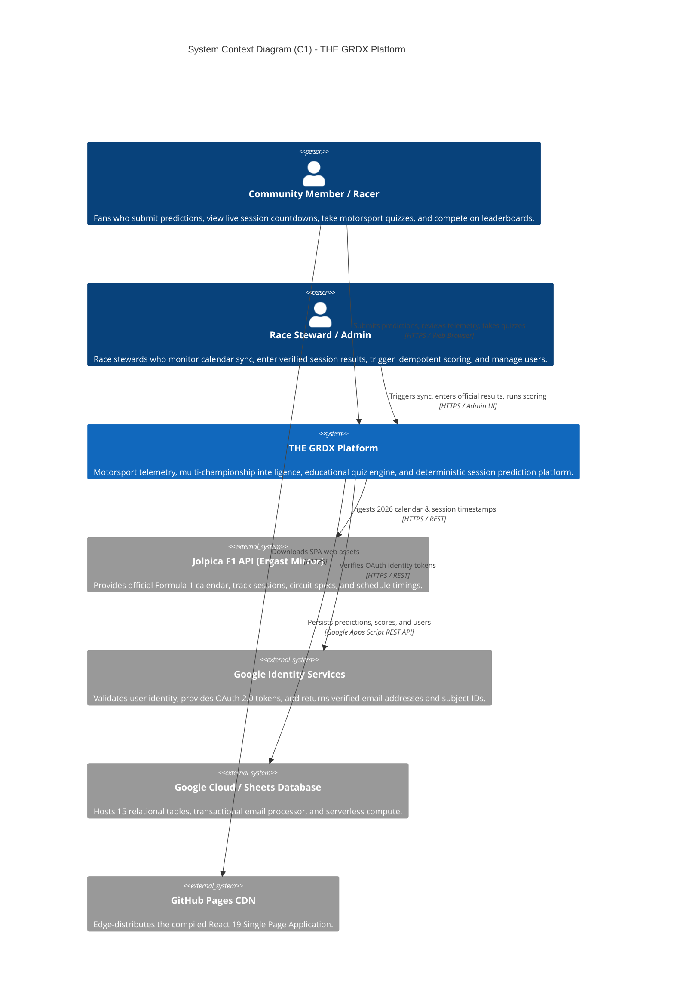

---

### 4.2 Level 2: Container Diagram (C2)

The Container diagram illustrates the high-level technical building blocks that execute THE GRDX.

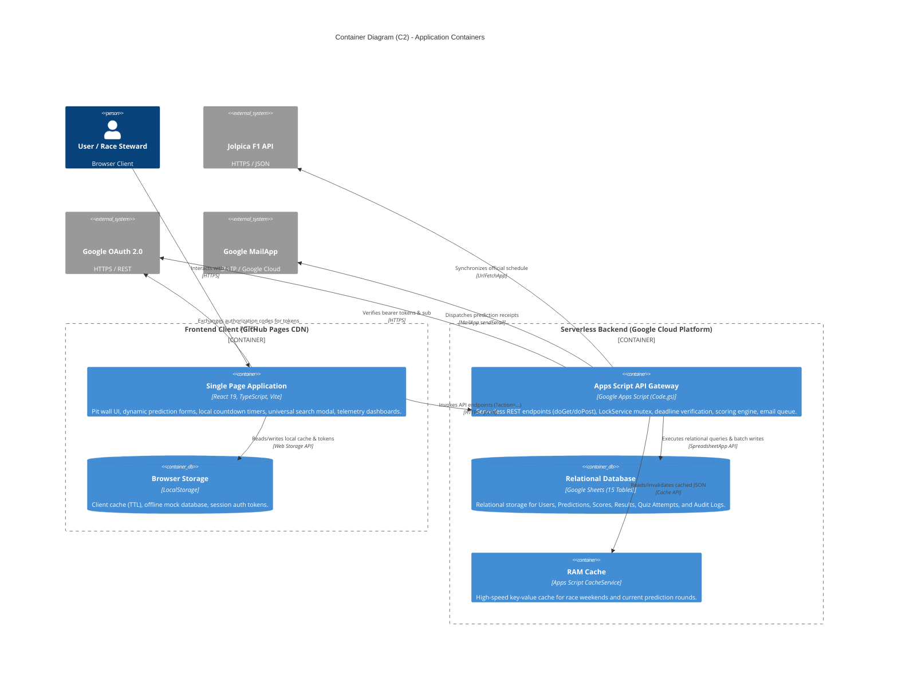

---

### 4.3 Level 3: Component Diagram (C3)

The Component diagram details the internal software components inside both the React Single Page Application and the Google Apps Script Backend.

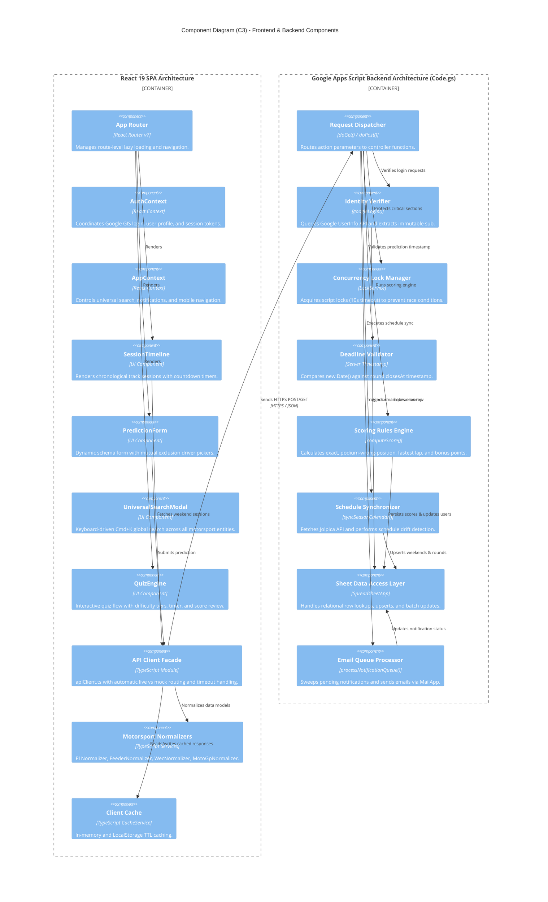

---

### 4.4 Level 4: Code-Level Class & Interface Diagram (C4)

The Code-level diagram details the core TypeScript interfaces, classes, and service adapters governing data flow.

```mermaid
classDiagram
    direction TB

    class F1DataProvider {
        <<interface>>
        +fetchSeasonCalendar(season: number) Promise~ProviderSeasonCalendar~
        +fetchRaceWeekend(season: number, round: number) Promise~ProviderRaceWeekend~
    }

    class JolpicaF1Provider {
        -BASE_URLS: string[]
        +fetchSeasonCalendar(season: number) Promise~ProviderSeasonCalendar~
        +fetchRaceWeekend(season: number, round: number) Promise~ProviderRaceWeekend~
        -fetchWithFallback(path: string) Promise~any~
        -normalizeRace(race: any) ProviderRaceWeekend
        -parseUtc(date: string, time: string) string
    }

    class F1ScheduleSyncService {
        -provider: F1DataProvider
        +syncSeasonCalendar(season: number, existingWeekends, existingRounds) Promise~SyncResult~
        +syncRaceWeekend(season: number, round: number) Promise~SyncResult~
        +detectScheduleChanges(existing, incoming) ScheduleChange[]
    }

    class WeekendFormatDetector {
        <<service>>
        +detectWeekendFormat(sessions: Session[]) "NORMAL" | "SPRINT"
        +hasSprintSessions(sessions: Session[]) boolean
    }

    class PredictionRoundGenerator {
        <<service>>
        +generatePredictionRounds(weekend: RaceWeekend, sessions: Session[], options?: GeneratorOptions) PredictionRound[]
        +getPredictionRoundStatus(round: PredictionRound, currentTime: Date) RoundStatus
    }

    class ScoringEngine {
        <<service>>
        +computeScore(prediction: Record, result: Record, rules: ScoringRules) ScoreResult
        +calculatePodiumPoints(predPodium, officialPodium) number
        +isIdempotent() boolean
    }

    class FeederNormalizer {
        <<service>>
        +normalizeDriver(raw: any, academyId?: string) NormalizedFeederDriver
        +normalizeEvent(raw: any, championship: string) NormalizedEvent
        +calculateSuperLicencePoints(championship: string, position: number) number
    }

    class ClientCache {
        <<service>>
        +get~T~(key: string) T | null
        +set~T~(key: string, data: T, ttlMs: number) void
        +invalidate(keyPrefix: string) void
    }

    F1DataProvider <|.. JolpicaF1Provider : Implements
    F1ScheduleSyncService --> F1DataProvider : Uses
    F1ScheduleSyncService --> WeekendFormatDetector : Uses
    F1ScheduleSyncService --> PredictionRoundGenerator : Uses
    ScoringEngine ..> PredictionRoundGenerator : Consumes Rules
```

---

## 5. Database Schema & Relational Data Model (15 Tables)

THE GRDX database is modeled as a relational system with **15 distinct worksheets** in Google Sheets (mirrored in `mockApi.ts` for offline execution).

### 5.1 Entity Relationship Diagram (ERD)

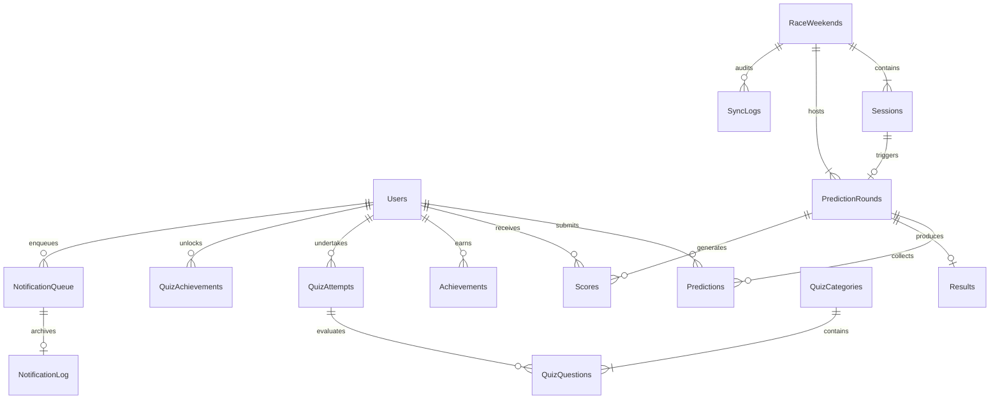

---

### 5.2 Complete Table Dictionaries

#### 1. `Users`
Stores player and steward credentials, profile preferences, and championship totals.
| Column | Type | Nullable | Description |
| :--- | :--- | :--- | :--- |
| `userId` (PK) | `string` | No | Internal immutable ID (e.g., `usr_harsh_4a7b2`) |
| `email` | `string` | No | Verified Google email address |
| `displayName` | `string` | No | Community screen name |
| `username` | `string` | No | Unique URL-safe handle (e.g., `harsh_v`) |
| `favouriteDriver` | `string` | Yes | Driver slug (e.g., `norris`, `leclerc`) |
| `favouriteConstructor`| `string` | Yes | Team slug (e.g., `mclaren`, `ferrari`) |
| `role` | `enum` | No | `'user'` \| `'admin'` |
| `createdAt` | `ISO8601` | No | Account registration timestamp |
| `totalPoints` | `number` | No | Aggregated season championship points |
| `seasonRank` | `number` | No | Current leaderboard standing position |
| `googleSubjectId` | `string` | No | Immutable Google Subject ID (`sub`) |
| `lastLoginAt` | `ISO8601` | Yes | Most recent authenticated session timestamp |

#### 2. `RaceWeekends`
Stores Grand Prix events and weekend-level metadata.
| Column | Type | Nullable | Description |
| :--- | :--- | :--- | :--- |
| `raceWeekendId` (PK) | `string` | No | Formatted ID (e.g., `2026_13`) |
| `season` | `number` | No | Championship season year (e.g., `2026`) |
| `round` | `number` | No | Official FIA round number (e.g., `13`) |
| `name` | `string` | No | Grand Prix title (e.g., `Italian Grand Prix`) |
| `country` | `string` | No | Host nation |
| `circuitId` | `string` | No | Circuit slug (e.g., `monza`) |
| `circuitName` | `string` | No | Official circuit venue |
| `weekendType` | `enum` | No | `'NORMAL'` \| `'SPRINT'` |
| `startDate` | `ISO8601` | No | Friday FP1 start timestamp |
| `endDate` | `ISO8601` | No | Sunday Grand Prix finish timestamp |
| `status` | `enum` | No | `'UPCOMING'` \| `'ACTIVE'` \| `'COMPLETED'` |
| `circuitLengthKm` | `number` | Yes | Lap distance in kilometres |
| `laps` | `number` | Yes | Official Grand Prix lap count |
| `lastSyncedAt` | `ISO8601` | Yes | Last Jolpica synchronization timestamp |

#### 3. `Sessions`
Stores all practice, qualifying, sprint, and grand prix sessions.
| Column | Type | Nullable | Description |
| :--- | :--- | :--- | :--- |
| `sessionId` (PK) | `string` | No | Formatted ID (e.g., `2026_13_QUALIFYING`) |
| `raceWeekendId` (FK) | `string` | No | References `RaceWeekends.raceWeekendId` |
| `sessionType` | `enum` | No | `'FP1'` \| `'FP2'` \| `'FP3'` \| `'SPRINT_QUALIFYING'` \| `'SPRINT'` \| `'QUALIFYING'` \| `'RACE'` |
| `name` | `string` | No | Display name (e.g., `Grand Prix Qualifying`) |
| `startTime` | `ISO8601` | No | Official scheduled green flag lights-out time |
| `endTime` | `ISO8601` | No | Projected chequered flag time |
| `status` | `enum` | No | `'UPCOMING'` \| `'ACTIVE'` \| `'COMPLETED'` |

#### 4. `PredictionRounds`
Stores dynamic prediction rounds with field configurations and strict deadlines.
| Column | Type | Nullable | Description |
| :--- | :--- | :--- | :--- |
| `roundId` (PK) | `string` | No | Formatted ID (e.g., `2026_13_RACE_PREDICTION`) |
| `raceWeekendId` (FK) | `string` | No | References `RaceWeekends.raceWeekendId` |
| `sessionId` (FK) | `string` | No | References `Sessions.sessionId` |
| `roundType` | `enum` | No | `'QUALIFYING'` \| `'SPRINT_QUALIFYING'` \| `'SPRINT'` \| `'RACE'` |
| `title` | `string` | No | Display title for players |
| `description` | `string` | Yes | Description and rules guidance |
| `opensAt` | `ISO8601` | No | When predictions open for submission |
| `closesAt` | `ISO8601` | No | Strict server deadline (5 min before lights-out) |
| `status` | `enum` | No | `'UPCOMING'` \| `'OPEN'` \| `'LOCKED'` \| `'COMPLETED'` \| `'SCORED'` |
| `predictionFields` | `JSON` | No | JSON array configuring active fields |
| `scoringRules` | `JSON` | No | JSON object defining point values |

#### 5. `Predictions`
Stores player prediction submissions with mutual exclusion driver selections.
| Column | Type | Nullable | Description |
| :--- | :--- | :--- | :--- |
| `predictionId` (PK) | `string` | No | Unique ID (e.g., `pred_9f8b2c4`) |
| `userId` (FK) | `string` | No | References `Users.userId` |
| `roundId` (FK) | `string` | No | References `PredictionRounds.roundId` |
| `predictionData` | `JSON` | No | `{ p1: "NOR", p2: "VER", p3: "PIA", fastestLap: "NOR", ... }` |
| `submittedAt` | `ISO8601` | No | Initial submission timestamp |
| `updatedAt` | `ISO8601` | No | Last update timestamp |
| `lockedAt` | `ISO8601` | Yes | Timestamp when prediction locked |

#### 6. `Results`
Stores verified official session outcomes submitted by Race Stewards.
| Column | Type | Nullable | Description |
| :--- | :--- | :--- | :--- |
| `resultId` (PK) | `string` | No | Unique ID (e.g., `res_3a8f9`) |
| `roundId` (FK) | `string` | No | References `PredictionRounds.roundId` |
| `resultData` | `JSON` | No | Official FIA verified outcomes `{ p1: "NOR", ... }` |
| `publishedAt` | `ISO8601` | No | Publication timestamp by Race Control |

#### 7. `Scores`
Stores calculated scores and category point breakdowns for each prediction.
| Column | Type | Nullable | Description |
| :--- | :--- | :--- | :--- |
| `scoreId` (PK) | `string` | No | Unique ID (e.g., `sc_11a4e`) |
| `userId` (FK) | `string` | No | References `Users.userId` |
| `roundId` (FK) | `string` | No | References `PredictionRounds.roundId` |
| `scoreBreakdown` | `JSON` | No | Detailed breakdown: `{ p1: 15, p2: 10, bonus: 10, ... }` |
| `totalScore` | `number` | No | Sum of all points earned in this round |
| `calculatedAt` | `ISO8601` | No | Timestamp of score computation |

#### 8. `Achievements`
Stores earned player trophies and achievement badges.
| Column | Type | Nullable | Description |
| :--- | :--- | :--- | :--- |
| `achievementId` (PK) | `string` | No | Unique ID (e.g., `ach_bullseye_usr1`) |
| `userId` (FK) | `string` | No | References `Users.userId` |
| `achievementType` | `enum` | No | `BULLSEYE`, `STRATEGY_MASTER`, `ON_FIRE`, `CONSISTENCY_KING`, etc. |
| `title` | `string` | No | Badge display title |
| `description` | `string` | No | Criteria description |
| `badgeIcon` | `string` | No | Icon identifier or emoji |
| `earnedAt` | `ISO8601` | No | Timestamp when criteria unlocked |

#### 9. `SyncLogs`
Audit log recording every external calendar sync and schedule drift detection.
| Column | Type | Nullable | Description |
| :--- | :--- | :--- | :--- |
| `logId` (PK) | `string` | No | Unique ID |
| `season` | `number` | No | Championship year |
| `raceWeekendId` | `string` | No | Grand Prix event ID |
| `action` | `enum` | No | `'CREATED'` \| `'UPDATED'` \| `'NO_CHANGE'` \| `'ERROR'` |
| `details` | `string` | No | Description of change detected |
| `timestamp` | `ISO8601` | No | Execution timestamp |

#### 10. `NotificationQueue`
Asynchronous message queue for transactional emails.
| Column | Type | Nullable | Description |
| :--- | :--- | :--- | :--- |
| `queueId` (PK) | `string` | No | Unique queue entry identifier |
| `recipientEmail` | `string` | No | Target recipient email address |
| `recipientName` | `string` | No | Recipient screen name |
| `notificationType` | `enum` | No | `'WELCOME'` \| `'PREDICTION_CONFIRMATION'` \| `'PREDICTION_RESULT'` |
| `subject` | `string` | No | Email subject line |
| `templateData` | `JSON` | No | Template variables payload |
| `idempotencyKey` | `string` | No | Unique key preventing duplicate delivery |
| `status` | `enum` | No | `'PENDING'` \| `'SENT'` \| `'RETRY'` \| `'FAILED'` |
| `attempts` | `number` | No | Count of delivery attempts (max 3) |
| `enqueuedAt` | `ISO8601` | No | Creation timestamp |
| `lastAttemptAt` | `ISO8601` | Yes | Most recent delivery attempt timestamp |

#### 11. `NotificationLog`
Immutable archive of all successfully delivered or permanently failed emails.
| Column | Type | Nullable | Description |
| :--- | :--- | :--- | :--- |
| `logId` (PK) | `string` | No | Unique log entry identifier |
| `queueId` | `string` | No | References `NotificationQueue.queueId` |
| `recipientEmail` | `string` | No | Recipient email address |
| `notificationType` | `string` | No | Type of notification delivered |
| `status` | `string` | No | Final status (`SENT` or `FAILED`) |
| `errorMessage` | `string` | Yes | Error details if failed |
| `sentAt` | `ISO8601` | No | Completion timestamp |

#### 12. `QuizCategories`
Motorsport disciplines available in the Knowledge Challenge.
| Column | Type | Nullable | Description |
| :--- | :--- | :--- | :--- |
| `categoryId` (PK) | `string` | No | Slug (e.g., `formula-1`, `motogp`, `endurance-racing`) |
| `name` | `string` | No | Display name |
| `discipline` | `string` | No | Broad discipline grouping |
| `icon` | `string` | No | Lucide icon identifier |
| `difficultyLevel` | `enum` | No | `'rookie'` \| `'midfield'` \| `'champion'` \| `'legend'` |
| `isLive` | `boolean` | No | Flag indicating if category is open |

#### 13. `QuizQuestions`
Verified motorsport question bank (120 questions across 8 categories).
| Column | Type | Nullable | Description |
| :--- | :--- | :--- | :--- |
| `questionId` (PK) | `string` | No | Unique ID (e.g., `q_f1_001`) |
| `categoryId` (FK) | `string` | No | References `QuizCategories.categoryId` |
| `prompt` | `string` | No | Question text |
| `options` | `JSON` | No | JSON array of 4 multiple-choice options |
| `correctOptionIndex` | `number` | No | Index of correct option (0-3) |
| `explanation` | `string` | No | Verified factual motorsport explanation |
| `difficulty` | `string` | No | Question difficulty tier |

#### 14. `QuizAttempts`
User quiz test attempts and results.
| Column | Type | Nullable | Description |
| :--- | :--- | :--- | :--- |
| `attemptId` (PK) | `string` | No | Unique ID (e.g., `att_17927...`) |
| `userId` (FK) | `string` | No | References `Users.userId` |
| `categoryId` (FK) | `string` | No | References `QuizCategories.categoryId` |
| `score` | `number` | No | Number of correct questions |
| `totalQuestions` | `number` | No | Total questions in attempt (15) |
| `percentage` | `number` | No | Score percentage |
| `fanIdentityTier` | `string` | No | Assigned tier: `Rookie`, `Enthusiast`, `Paddock Insider`, `Race Engineer` |
| `completedAt` | `ISO8601` | No | Completion timestamp |

#### 15. `QuizAchievements`
Unlocked badges for the motorsport knowledge engine.
| Column | Type | Nullable | Description |
| :--- | :--- | :--- | :--- |
| `id` (PK) | `string` | No | Unique ID |
| `userId` (FK) | `string` | No | References `Users.userId` |
| `badgeKey` | `string` | No | `first-lap`, `consistent-racer`, `podium-performance`, `motorsport-oracle`, `all-rounder` |
| `title` | `string` | No | Badge name |
| `earnedAt` | `ISO8601` | No | Timestamp of unlocking |

---

## 6. Platform Security & Protection Architecture

Security is architected with defense-in-depth across the client, API gateway, and database layers.

### 6.1 Authentication & Passwordless Identity Protection
* **Google Identity Services (GIS) Exclusivity:** The platform avoids password management entirely. Users authenticate through Google OAuth 2.0 / OpenID Connect.
* **Server-Side Token Verification:** The client is never trusted. Upon receiving a login payload, `backend/Code.gs` makes an independent HTTPS call to Google's UserInfo API (`https://www.googleapis.com/oauth2/v3/userinfo`) using the received `access_token`. Apps Script verifies that the response is HTTP 200, that the email is verified (`email_verified === true`), and extracts the immutable Google Subject ID (`sub`).
* **Immutable Identity Anchor (`sub`):** Accounts are indexed by their Google Subject ID (`googleSubjectId`). Even if a user changes their primary Google account email, their prediction history, championship points, and roles remain securely bound to their immutable `sub`.

### 6.2 Concurrency & Race Condition Defense (LockService)
* **Distributed Mutex:** Google Apps Script executes concurrently across Google's cloud infrastructure. To prevent race conditions, critical sections utilize `LockService.getScriptLock()`.
* **User Registration Lock:** When a new user logs in for the first time, a script lock with a 10-second timeout is acquired. Concurrent first-time requests resolve sequentially, ensuring duplicate user rows are never created.
* **Scoring & Notification Lock:** When Race Control triggers scoring or sweeps the notification queue, script locking ensures two concurrent workers never process the same score or deliver duplicate emails.

### 6.3 Server-Controlled Deadline Verification & Anti-Cheat Engine
* **Client Clocks Are Strictly Untrusted:** The countdown timers in the React UI are purely for user experience.
* **Server Timestamp Check:** When `submitPrediction` is invoked in `Code.gs`, the server obtains the atomic server time via `new Date().getTime()`. It looks up the target `PredictionRound.closesAt` in the database.
* **Strict Lockout:** If `serverTime > closesAt`, the request is rejected with `{ success: false, message: "Predictions are LOCKED" }`. Tampering with client local storage or system clocks cannot bypass the server lockout.

### 6.4 Mutual Exclusion & Input Sanitization
* **Client-Side Exclusion:** Selecting a driver for P1 automatically disables that driver in the dropdowns for P2 and P3.
* **Server-Side Validation:** The backend enforces mutual exclusion independently:
  ```javascript
  const podium = [payload.predictionData.p1, payload.predictionData.p2, payload.predictionData.p3];
  const uniqueDrivers = new Set(podium.filter(Boolean));
  if (uniqueDrivers.size !== 3) {
    throw new Error("Podium predictions must contain three distinct drivers.");
  }
  ```
* **Payload Sanitization:** All incoming strings (user handles, driver slugs, question responses) are sanitized and stripped of HTML/script injection tags before storage.

### 6.5 Role-Based Access Control (RBAC)
* **Server-Side Role Storage:** A user's role is stored exclusively in Column H of the `Users` sheet. Client claims of `role: 'admin'` are stripped.
* **Steward Protection:** Administrative endpoints (`adminSaveWeekend`, `adminSubmitResult`, `adminCalculateScores`, `getAdminUsers`) require a `requesterId` parameter. The backend queries the database, verifies that the user exists and has `role === 'admin'`. Non-admin requests fail with `403 Forbidden: Administrator privileges required`.

### 6.6 Anti-Spam & Notification Protection
* **Deterministic Idempotency Keys:** Every transactional notification generated by the platform is assigned a deterministic key:
  * Welcome email: `WELCOME_{userId}`
  * Prediction receipt: `PRED_{userId}_{roundId}`
  * Race results: `RESULT_{userId}_{roundId}`
* **Deduplication:** Before inserting into `NotificationQueue`, the system checks both the active queue and the historical `NotificationLog`. If an entry with the idempotency key exists, enqueuing is silently skipped.
* **Failure Isolation:** Email delivery failures never roll back user predictions or score calculations. Notifications retry up to 3 times with exponential backoff before being marked as `FAILED`.

### 6.7 Network Resilience, Timeout & Cold-Start Tolerance
* **Google Apps Script Cold Starts:** Serverless Google Apps Script containers can take up to 2-4 seconds to spin up from a cold state.
* **Resilient Fetch Client:** In `src/services/apiClient.ts`, network requests pass through `fetchWithTimeout()` featuring an `AbortController` (25s timeout) and automatic retry backoff.
* **Client-Side Caching (TTL):** Frequent read queries (such as schedule calendars and circuit metadata) are cached in `clientCache` with a 10-minute TTL, eliminating redundant backend round-trips.

### 6.8 Data Privacy & Universal Platform Auditor
* **Public Leaderboard Privacy:** The public leaderboard API masks user email addresses and full names, exposing only public handles (`username`), avatar initials, and telemetry statistics.
* **Universal Platform Auditor (`auditPlatformData`):** An automated audit script built into `Code.gs` inspects database health, detects duplicate rows or orphaned predictions, and automatically generates timestamped backup sheets before executing any batch remediation.

---

## 7. Exhaustive Feature Directory

### 7.1 Dynamic Prediction Bench & Session Rounds
* **Dynamic Round Generation:** Supports Conventional weekends (Qualifying + Race) and Sprint weekends (Sprint Qualifying + Sprint Race + Qualifying + Race).
* **Configurable Prediction Fields:**
  * **P1, P2, P3:** Predicted podium positions (with mutual exclusion).
  * **Fastest Lap:** Predicted driver to set the official fastest lap.
  * **Driver of the Day:** Predicted fan-voted Driver of the Day.
  * **Session Wildcard:** Dynamic context questions (e.g. "Will there be a Safety Car?", "Will there be a Red Flag?", "Will both McLarens finish in the top 5?").
* **Round Lifecycle States:** `UPCOMING` → `OPEN` → `LOCKED` → `COMPLETED` → `SCORED`.

### 7.2 Race Calendar & Localized Chronological Timeline
* **Full Season Schedule:** 24 official Formula 1 championship weekends with country flags, circuit names, and round numbers.
* **Local Timezone Conversion:** Automatically parses UTC session timestamps and converts them to the user's browser local time (e.g. IST, GMT, EST).
* **Chronological Session Timeline:** Interleaves practice sessions (FP1, FP2, FP3) with competitive prediction rounds, live countdown clocks, and circuit track maps.
* **iCalendar (.ics) Subscription:** Users can subscribe to the calendar feed directly in Apple Calendar, Google Calendar, or Microsoft Outlook with auto-updating session times.

### 7.3 Scoring Engine & Points Breakdown
* **Exact P1:** `15 points`
* **Exact P2 / P3:** `10 points each`
* **Podium Driver in Wrong Position:** `5 points` (awarded if a driver finishes on the podium but in a different position than predicted)
* **🎯 Perfect 1-2-3 Podium Bonus:** `+10 points` (awarded only when P1, P2, and P3 are all exactly correct)
* **Fastest Lap:** `10 points`
* **Driver of the Day:** `10 points`
* **Session Wildcard:** `15 points`
* **Maximum Possible Single Session Score:** `80 points`
* **Scoring Idempotency:** Calculating scores multiple times produces identical points and never creates duplicate rows.

### 7.4 Three-Tier Leaderboards
1. **Tier 1 — Session Leaderboard:** Individual round breakdown showing exact points earned per field for a single race or qualifying session.
2. **Tier 2 — Weekend Championship:** Aggregated points earned across all sessions of a single Grand Prix weekend (combining Sprint and GP points).
3. **Tier 3 — Season Championship:** Comprehensive global standings with rank change indicators (`+2`, `-1`, `=`), total points, average points per race, exact P1 counts, and champion crown badges.

### 7.5 Driver Profile, Telemetry & Achievement Badges
* **Telemetry Statistics:** Prediction accuracy %, exact P1 count, perfect podium count, and wildcard success rate.
* **Customization:** Users can set their unique username handle, avatar initials, favourite driver, and favourite constructor.
* **Achievement Badges:**
  * 🎯 **Bullseye:** Predict the exact race winner.
  * 👑 **Strategy Master:** Score a perfect 1-2-3 podium.
  * 🔥 **On Fire:** Finish in the top 3 of a weekend leaderboard.
  * ⚡ **Consistency King:** Submit predictions for 5 consecutive race weekends.
  * 🐎 **Ferrari Strategist:** Score 0 points on a session prediction.

### 7.6 Explore & Multi-Championship Hub (F1, F2, F3, WEC, MotoGP)
* **Formula 1:** Full 2026 driver grid, constructors, team principals, power unit manufacturers, and technical regulations.
* **Formula 2 & Formula 3:** Official feeder series hub with reverse-grid sprint rules (top 10 for F2, top 12 for F3), feature race points, and pole position bonuses.
* **World Endurance Championship (WEC):** Hypercar and LMGT3 category tracking, endurance race duration tiers (6h, 8h, 24h), and multi-tier points scales.
* **MotoGP:** Grand Prix riders, factory teams, independent teams, Saturday Sprint points, and official manufacturer concession tiers (A, B, C, D).

### 7.7 Junior Driver Academies & Super Licence Progression
* **8 Official Junior Academies:** Detailed registry covering Ferrari Driver Academy, Red Bull Junior Team, Mercedes Junior Team, McLaren Driver Development, Alpine Academy, Williams Driver Academy, Sauber Academy, and Aston Martin Driver Development.
* **FIA Super Licence Matrix:** Dynamic calculator showing Super Licence points awarded for championship finishes in F2, F3, and other FIA-sanctioned feeder championships (40 points required for F1 eligibility).

### 7.8 Indian Motorsport Portal
* **Dedicated Heritage Portal:** Explores India's rich motorsport history and current racing ecosystem.
* **Pioneering Drivers:** Detailed profiles for Narain Karthikeyan (India's first F1 driver), Karun Chandhok, Jehan Daruvala, Kush Maini, and Advait Deodhar.
* **National Championships:** Coverage of the JK Tyre National Racing Championship and MRF Challenge.
* **Iconic Venues:** Buddh International Circuit (BIC, Greater Noida), Madras Motor Race Track (MMRT, Chennai), Kari Motor Speedway (Coimbatore), and the Hyderabad E-Prix street circuit.

### 7.9 Circuits Compendium & Interactive SVG Vector Track Maps
* **All 24 Championship Circuits:** Handcrafted, high-resolution SVG track vectors with telemetry styling.
* **Technical Circuit Specs:** Track length (km), official lap records, corner counts, DRS detection and activation zones, track elevation profiles, and historical race statistics.

### 7.10 Motorsport Learning Hub & Technical Regulation Guides
* **Aerodynamics:** Ground effect venturi tunnels, DRS mechanics, wake turbulence, dirty air, and downforce generation.
* **Tyre Strategy:** Pirelli compounds (C1 through C5, Intermediates, Full Wets), thermal degradation, undercut vs. overcut pit stop tactics.
* **Powertrain & ERS:** Internal Combustion Engine (ICE), Turbocharger, MGU-K (Kinetic), MGU-H (Heat), battery energy deployment limits.
* **Flags & Rules:** Green, Yellow, Double Yellow, Red, Blue, Black & White, and Chequered flag regulations, plus Safety Car (SC) and Virtual Safety Car (VSC) delta times.

### 7.11 Motorsport Fan Identity Quiz Engine
* **8 Verified Categories:** Formula 1, Formula 2, Formula 3, Formula 4, Formula E, MotoGP, Endurance Racing (WEC), and GT Racing.
* **120 Question Verified Bank:** 15 verified questions per category with four options and detailed factual explanations.
* **Fan Identity Tiering:** Evaluates responses and assigns a motorsport fan persona:
  * 🔰 *The Rookie* (<40%)
  * 🏎️ *The Enthusiast* (40-69%)
  * 🏁 *Paddock Insider* (70-89%)
  * 🏆 *Race Engineer / Motorsport Oracle* (90-100%)
* **Quiz Achievements:** Unlocks dedicated knowledge badges (`first-lap`, `consistent-racer`, `podium-performance`, `motorsport-oracle`, `all-rounder`) kept strictly isolated from prediction league points.

### 7.12 Universal Command Search (Cmd+K / Ctrl+K)
* **Global Search Palette:** Accessible anywhere in the application via `Cmd+K` (Mac) or `Ctrl+K` (Windows/Linux) or the navbar magnifying glass.
* **Multi-Entity Indexing:** Instant fuzzy searching across circuits, drivers, teams, championships, race weekends, and educational topics with keyboard arrow navigation.

### 7.13 Admin Race Control Dashboard
* **Live Jolpica Calendar Sync:** One-click trigger to fetch live Formula 1 schedules, detect changes, and update prediction deadlines.
* **Verified Results Entry:** Stewards input official session winners, podiums, fastest lap drivers, and wildcard answers.
* **One-Click Scoring:** Executes deterministic batch score calculations and automatically updates global leaderboard standings.
* **User Management:** Stewards inspect the user directory, view login history, audit prediction submissions, and manage administrative roles.
* **Sync & Audit Logs:** Displays live audit records from `SyncLogs` detailing all schedule additions or modifications.

### 7.14 Asynchronous Notification Queue & Email Dispatch
* **Decoupled Architecture:** User registration and prediction saves are never delayed by SMTP network requests. Notifications are written to `NotificationQueue` first.
* **Batch Processor:** The `processNotificationQueue` function sweeps pending rows, verifies idempotency keys, and dispatches HTML emails via Google Cloud `MailApp`.
* **Delivery Isolation:** Network delivery failures are logged to `NotificationLog` and retried automatically without invalidating user predictions or championship points.

### 7.15 Dual-Backend & Offline Simulation Engine
* **Production Live Mode:** Connects to the Google Apps Script Web App when `VITE_API_URL` is set in the environment.
* **Zero-Config Offline Mode:** When running locally without an API URL, the app switches to `mockApi.ts` and `localStorage`. Pre-seeded with the full 2026 driver lineup, 24 circuits, and sample predictions for instant evaluation.

---

## 8. End-to-End System Workflows & Sequence Diagrams

### Workflow 1: Google GIS Authentication & Onboarding

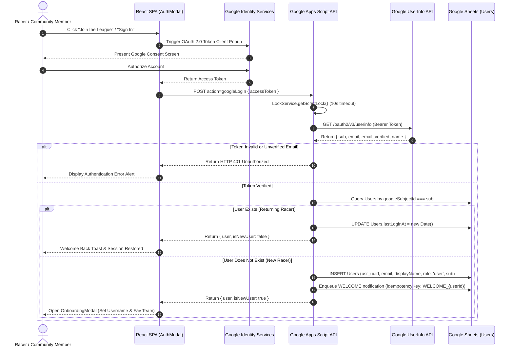

---

### Workflow 2: External Calendar Synchronization & Schedule Drift Detection

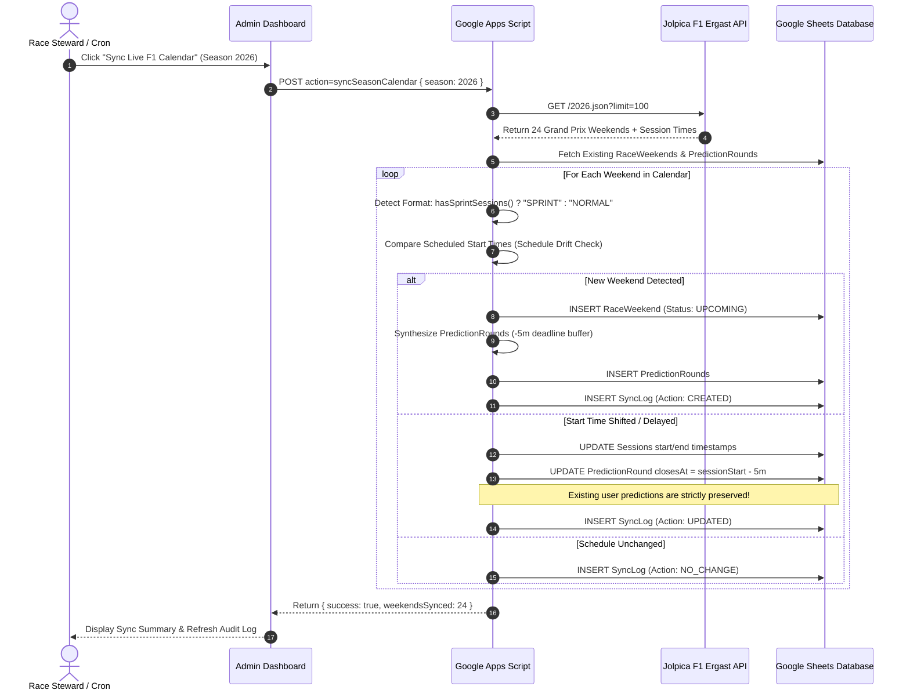

---

### Workflow 3: Prediction Submission & Deadline Enforcement

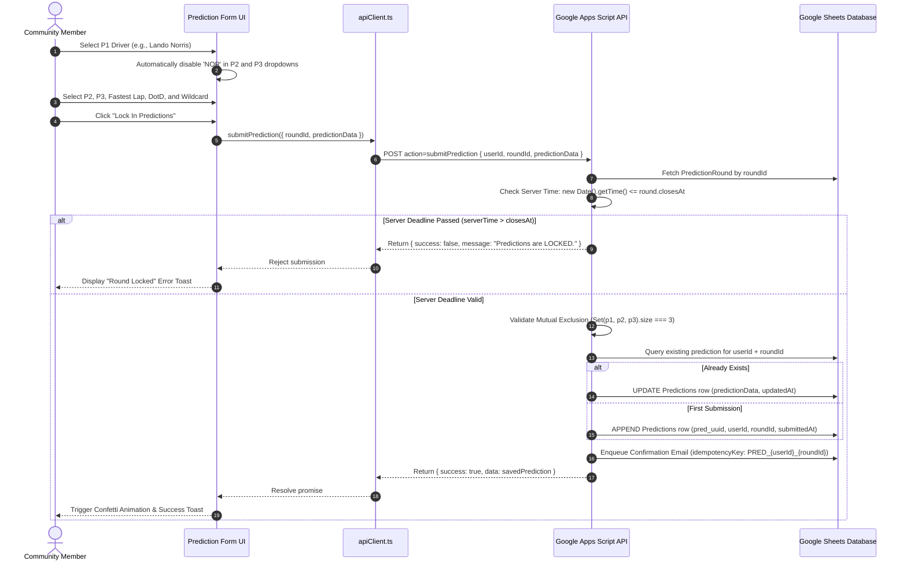

---

### Workflow 4: Official Results Ingestion & Idempotent Scoring Pipeline

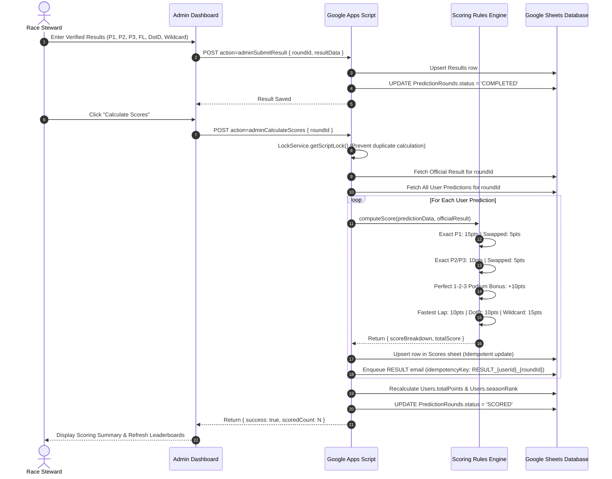

---

### Workflow 5: Three-Tier Championship Leaderboard Aggregation

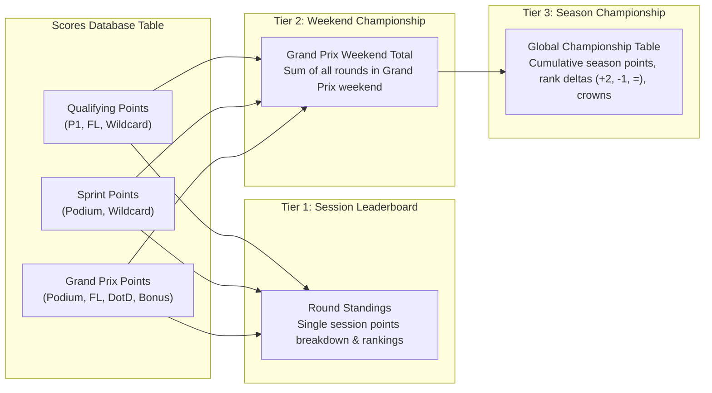

---

### Workflow 6: Motorsport Quiz Attempt Lifecycle & Tier Assignment

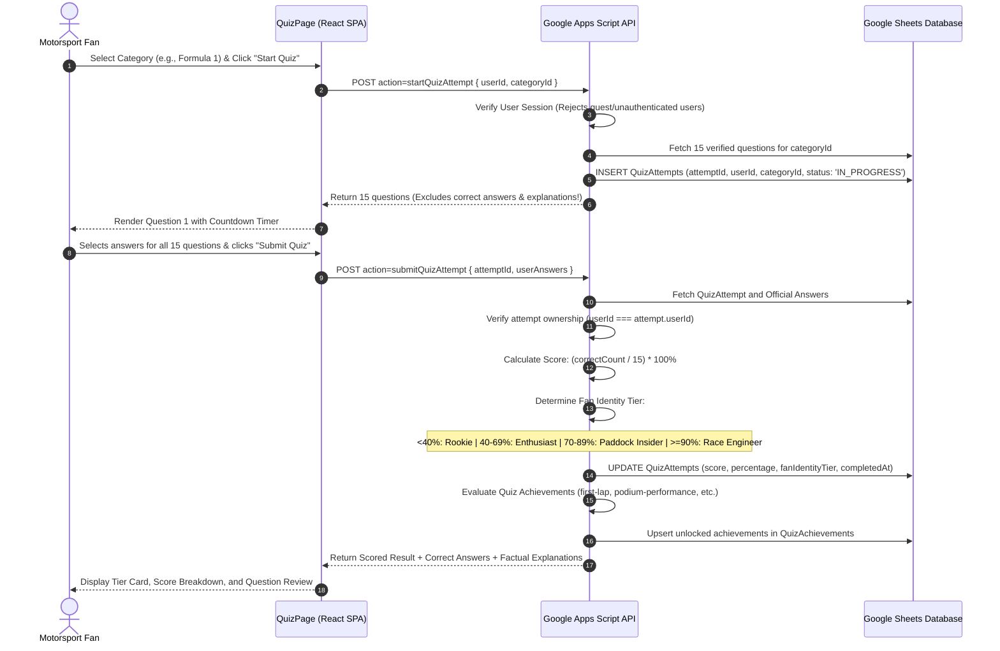

---

### Workflow 7: Asynchronous Notification Queue & MailApp Delivery

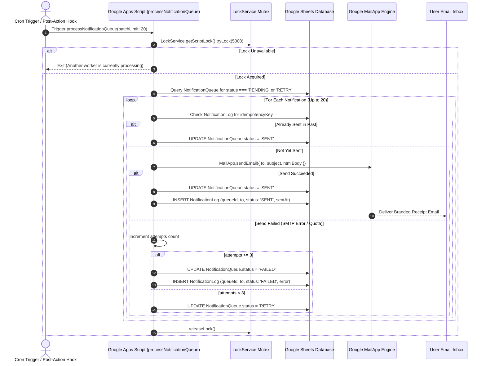

---

## 9. Deployment Flow, Hosting & CI/CD Pipeline

### 9.1 Continuous Integration & GitHub Actions Workflow

THE GRDX utilizes an automated CI/CD pipeline defined in [`.github/workflows/deploy.yml`](file:///c:/Users/harsh/Desktop/Projects/My%20Projects/F1%20Prediction%20Wall/.github/workflows/deploy.yml).

Every commit pushed to the `main` branch automatically triggers the following pipeline:

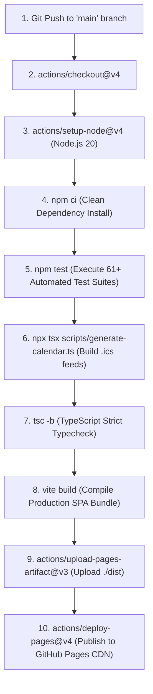

#### Pipeline Security & Environment Variable Injection:
* `VITE_API_URL`: Injected during step 8 to point the compiled client to the production Google Apps Script Web App URL.
* `VITE_GOOGLE_CLIENT_ID`: Injected to initialize Google Identity Services OAuth 2.0 with the registered Google Cloud OAuth Client ID.

---

### 9.2 Google Apps Script Production Deployment

To deploy or update the serverless backend:
1. Open the linked Google Spreadsheet: **`F1 Prediction League Database`**.
2. Navigate to **Extensions > Apps Script**.
3. Paste the contents of [`backend/Code.gs`](file:///c:/Users/harsh/Desktop/Projects/My%20Projects/F1%20Prediction%20Wall/backend/Code.gs) into the project editor.
4. Click **Deploy > New deployment**.
5. Select **Web app** as the deployment type:
   * **Description:** `THE GRDX Production API v2`
   * **Execute as:** `Me (your_admin_email@gmail.com)`
   * **Who has access:** `Anyone` *(Crucial: allows client browsers to issue cross-origin REST requests without Google sign-in popups on read queries)*
6. Copy the generated **Web App URL** (e.g. `https://script.google.com/macros/s/AKfycb.../exec`).
7. Update the GitHub repository secret or `.env.production` file:
   ```env
   VITE_API_URL=https://script.google.com/macros/s/AKfycb.../exec
   ```

---

### 9.3 SPA Routing & GitHub Pages 404 Fallback

Because GitHub Pages is a static file host, requests to deep routes like `https://hj1418.github.io/F1-Prediction-Wall/predict/2026_13_RACE` would return a 404 error on a server without SPA awareness.

THE GRDX solves this cleanly through two mechanisms:
1. **HashRouter Navigation:** Client routes are prefixed with `#` (e.g., `#/predict/2026_13_RACE`), which the browser interprets locally without issuing a server HTTP GET request.
2. **`public/404.html` Redirection Script:** For legacy or direct path requests, `public/404.html` captures the intended URL pathname, converts it into a query string redirect, and returns the visitor back into `index.html` seamlessly.

---

## 10. Strategic Engineering Roadmap

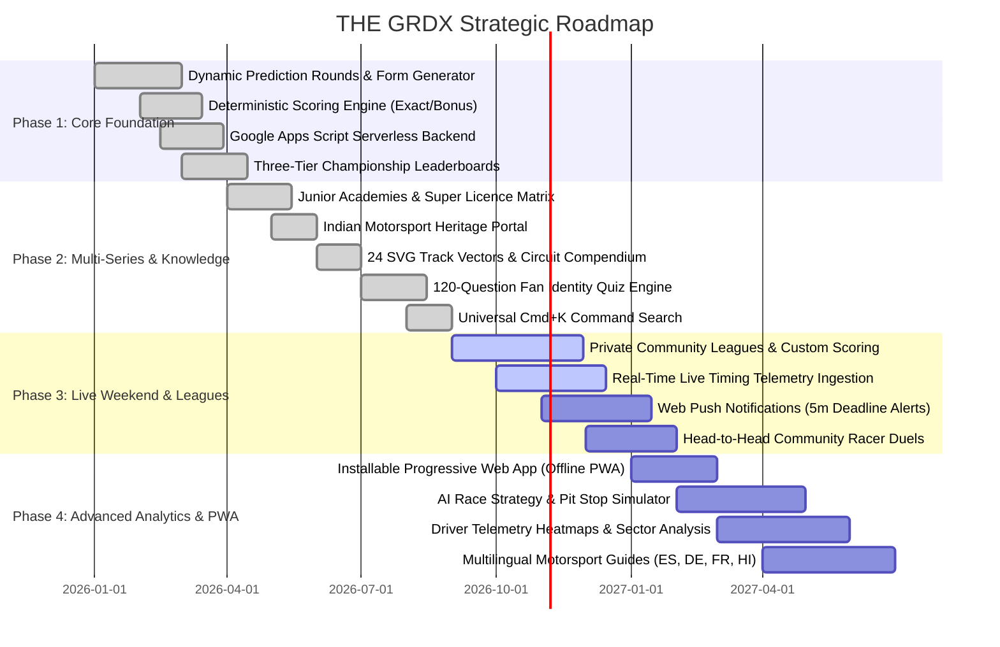

### Detailed Phase Breakdown:

* **Phase 1: Core Foundation & Prediction Mechanics (Completed)**
  * Generic prediction round synthesis for conventional and sprint weekends.
  * Modular scoring engine (P1/P2/P3, podium wrong-position, fastest lap, driver of the day, wildcard, perfect 1-2-3 bonus).
  * Serverless Google Apps Script backend and Google Sheets relational database.
  * Three-tier leaderboards (Session, Weekend, Season).

* **Phase 2: Multi-Series Expansion & Knowledge Engine (Completed)**
  * Feeder series coverage: Formula 2 and Formula 3 reverse grid rules and points scales.
  * 8 Junior Driver Academies registry and FIA Super Licence progression matrices.
  * Dedicated Indian Motorsport heritage portal celebrating national circuits and drivers.
  * 24 high-resolution SVG track vectors with telemetry layouts and sector specs.
  * Motorsport Fan Identity Quiz Engine with 120 verified questions across 8 disciplines.
  * Global `Cmd+K` / `Ctrl+K` keyboard-driven command search.

* **Phase 3: Live Race Weekend Enhancements & Community Leagues (In Progress)**
  * **Private Community Leagues:** Allowing friends, offices, or fan clubs to create private mini-leagues with customized scoring weights and invite codes.
  * **Real-Time Live Timing Ingestion:** Ingesting live sector times and driver positions during Grand Prix sessions.
  * **Web Push Notifications:** Browser push notifications sent 15 minutes and 5 minutes prior to session prediction deadlines.
  * **Head-to-Head Racer Duels:** Direct 1-on-1 weekly prediction challenges between community racers.

* **Phase 4: Advanced Telemetry Analytics & Mobile PWA (Upcoming)**
  * **Progressive Web App (PWA):** Offline service workers, add-to-homescreen capability, and background sync.
  * **AI Race Strategy Predictor:** Machine learning simulation predicting pit stop windows and tyre degradation based on historical telemetry.
  * **Sector Heatmaps & Telemetry Analysis:** Interactive speed trace and apex speed comparisons across Qualifying laps.
  * **Multilingual Localization:** Expanding educational guides and quiz questions into Spanish, German, French, and Hindi.

---

*Authored for THE GRDX (F1 Prediction Wall) Project. MIT License © 2026 Harsh Vardhan.*
