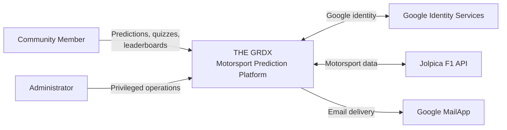
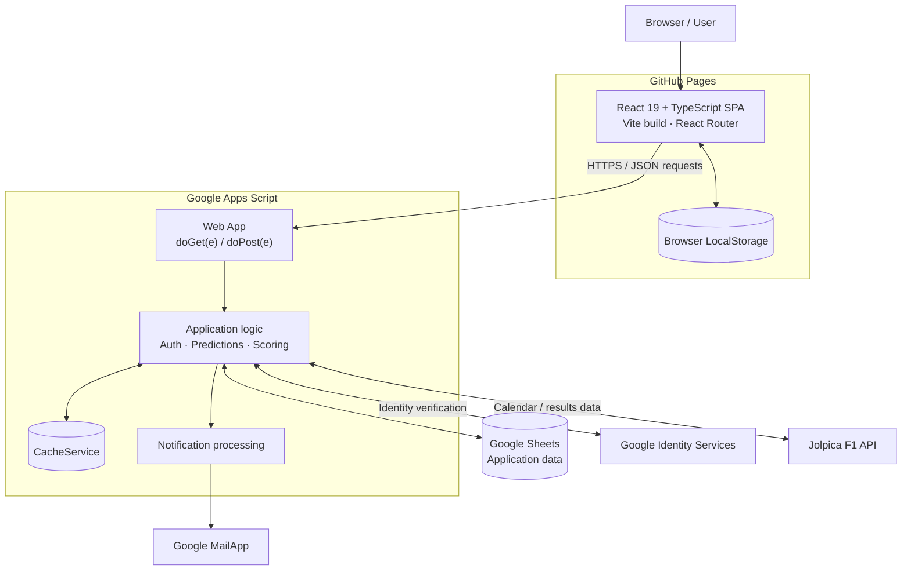
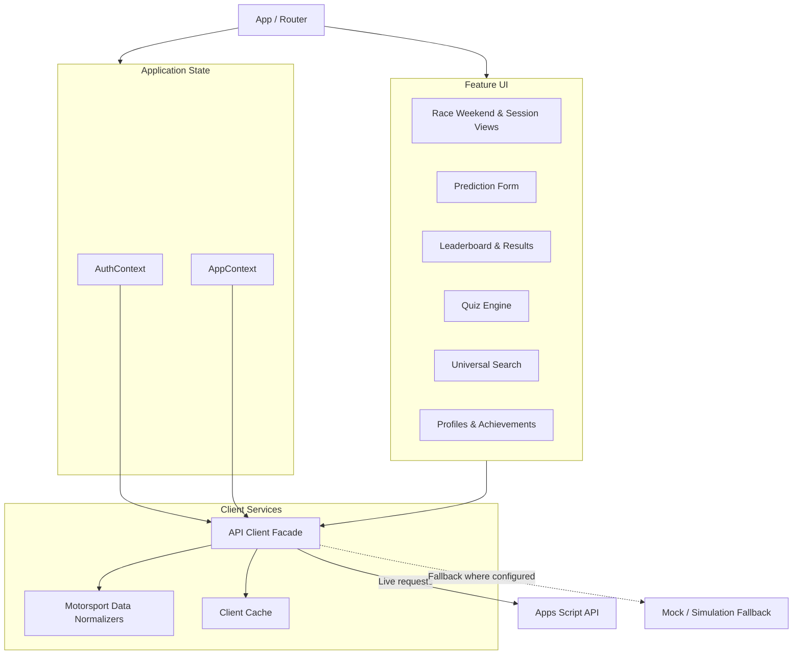
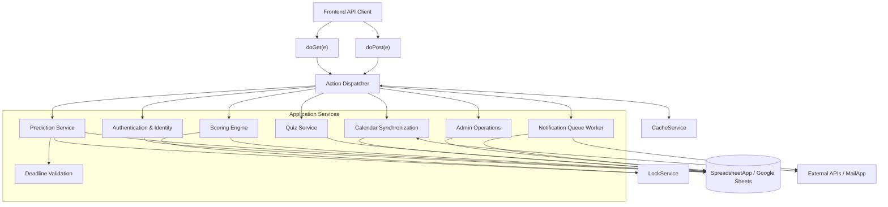
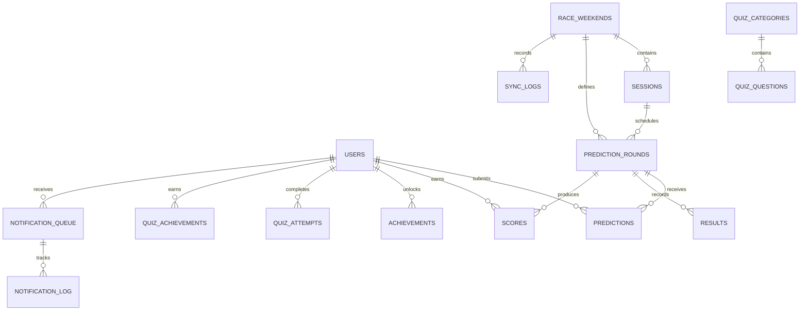
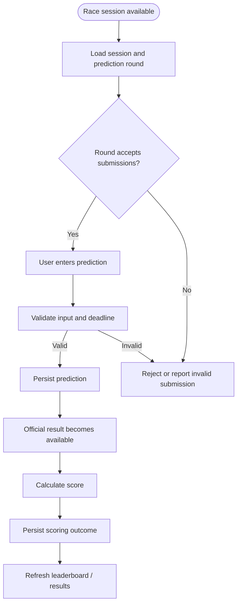
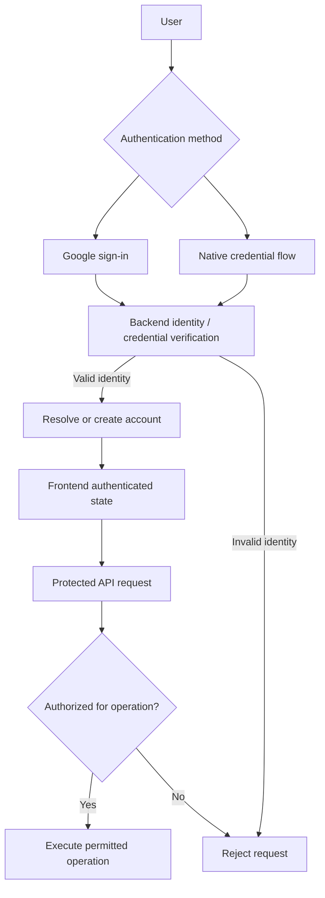
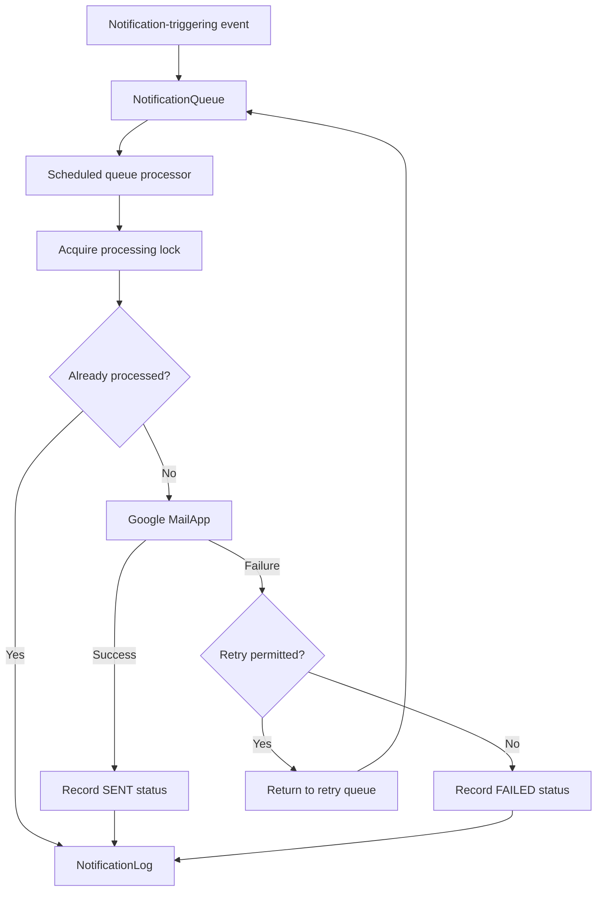
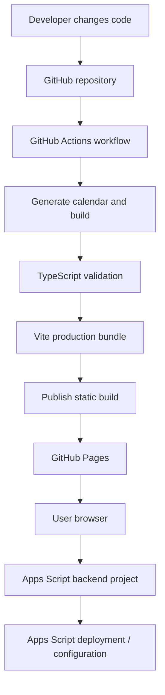
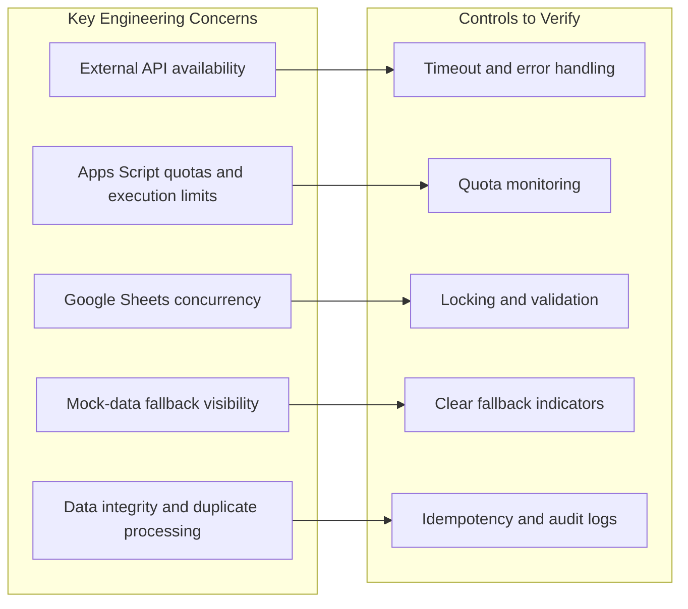

# THE GRDX — Complete Technical Architecture Presentation

**Slide-by-slide blueprint**  
**Format:** Technical architecture presentation  
**Scope:** Architecture diagrams, slide content, and speaker notes  
**Note:** This is a blueprint for designing the slides yourself, not a generated PPT or PDF.

This plan follows the C4 architecture model, then covers data, security, workflows, and deployment. Mermaid diagrams are included as editable text references for recreating the diagrams in PowerPoint, Figma, or diagrams.net.

## Deck Structure

1. System Context (C4 Level 1)
2. Container Architecture (C4 Level 2)
3. Frontend Component Architecture (C4 Level 3)
4. Backend Component Architecture (C4 Level 3)
5. Data Model and Entity Relationship Diagram
6. Prediction Lifecycle and Scoring
7. Authentication, Authorization, and Data Integrity
8. Asynchronous Email Notification Architecture
9. CI/CD, Hosting, and Deployment
10. Reliability, Limitations, and Engineering Considerations

---

## Slide 1 — System Context (C4 Level 1)

**Purpose:** Establish the system boundary and show the people and external services interacting with THE GRDX.

### Content

- Race-weekend predictions and session-specific rounds.
- Prediction scoring and leaderboards.
- Motorsport quizzes and learning content.
- User accounts, profiles, and notifications.
- External identity, motorsport-data, and email integrations.

**Speaker notes:**  
“THE GRDX provides a motorsport-focused prediction and community experience. This context view establishes the system boundary before we examine its internal architecture.”

**Validation note:** The repository documents these integrations, but confirm that each is enabled and actively used in the current production deployment before describing it as a live dependency.

---

## Slide 2 — Container Architecture (C4 Level 2)

**Purpose:** Show the major executable units, hosting locations, and data stores.

### Container Summary

| Container | Technology | Responsibility |
|---|---|---|
| Frontend | React 19, TypeScript, Vite, React Router | UI, navigation, user interactions |
| Backend | Google Apps Script V8 | API requests and business logic |
| Persistent store | Google Sheets | Structured application records |
| Browser storage | LocalStorage | Client-side persistence or caching |
| Backend cache | CacheService | Temporary cached values |
| External services | Google identity, Jolpica, MailApp | Authentication, data, email |

**Speaker notes:**  
“The frontend is a static web application, while the backend runs in Apps Script. Google Sheets provides the main persistent data store, avoiding the need to operate a conventional application server and database server.”

**Validation note:** The exact request paths and whether every API action reaches the live backend must be checked against the frontend API client. The repository includes mock-data fallback behavior.

---

## Slide 3 — Frontend Component Architecture (C4 Level 3)

**Purpose:** Explain how the frontend separates navigation, state, API communication, and feature modules.

### Content

- **Routing:** Application pages and navigation.
- **State management:** Authentication and application-level context.
- **Feature modules:** Predictions, quizzes, race sessions, search, profiles, and leaderboards.
- **API facade:** Centralizes frontend-to-backend communication.
- **Normalization and cache:** Transforms external data and reuses cached results where configured.
- **Fallback behavior:** Some client flows can use mock data when the live API is unavailable or bypassed.

**Speaker notes:**  
“The frontend is organized around feature UI, shared context, and a client-service layer. This separation keeps UI components from needing to manage every backend detail themselves.”

**Validation note:** Treat these as architectural groupings, not necessarily the exact names of every component file. Confirm the actual imports and call relationships before drawing fine-grained module dependencies.

---

## Slide 4 — Backend Component Architecture (C4 Level 3)

**Purpose:** Show how API requests enter the backend and reach application services and storage.

### Responsibilities

- `doGet(e)` and `doPost(e)` receive incoming web-app requests.
- The action dispatcher routes requests to the relevant operation.
- Authentication and authorization protect account and privileged operations.
- Prediction logic validates input and deadlines before persistence.
- Scoring calculates points from predictions and results.
- Calendar synchronization updates motorsport schedule information.
- Quiz services manage quiz-related operations.
- Notification processing handles queued email work.
- Google Sheets is accessed through Apps Script's spreadsheet services.

**Speaker notes:**  
“The backend is organized around an action-dispatch pattern rather than a set of separately deployed microservices. Its services execute inside the same Apps Script project.”

**Validation note:** This is a conceptual component map. In the final version, remove any arrow or component that cannot be traced to an actual handler or function in `backend/Code.gs`.

---

## Slide 5 — Data Model and Entity Relationship Diagram

**Purpose:** Explain how users, race weekends, predictions, results, and scores relate to one another.

The architecture document describes a 15-worksheet data model. Use the actual worksheet headers and references from `backend/SetupSheet.gs` and `backend/Code.gs` to finalize the ERD.

### How to Explain the Model

- **Users** connect account identity to predictions, scores, achievements, quiz attempts, and notifications.
- **Race weekends and sessions** organize the motorsport calendar.
- **Prediction rounds** define the specific prediction opportunity and connect it to submitted predictions and official results.
- **Scores** associate prediction outcomes with points.
- **Quiz categories and questions** organize learning and quiz content.
- **Notification records** support tracking of queued messages and delivery outcomes.

**Important:** This is a conceptual ERD based on relationships described in `docs/ARCHITECTURE.md`. It is not yet a verified physical schema. Google Sheets does not enforce relational foreign keys like a conventional SQL database. Before publishing, verify the real worksheet names, key columns, uniqueness rules, and lookup logic in the code.

**Speaker notes:**  
“The data model separates identity, race structure, prediction submissions, official results, scoring, and engagement features. This makes the business relationships easier to reason about even though the persistence layer is Google Sheets.”

---

## Slide 6 — Prediction Lifecycle and Scoring

**Purpose:** Demonstrate the core business workflow, from opening a prediction round through calculating a user's score.

### Documented Scoring Model

| Prediction outcome | Documented points |
|---|---:|
| Exact P1 | 15 |
| Exact P2 | 10 |
| Exact P3 | 10 |
| Correct podium driver, wrong position | 5 |
| Perfect 1–2–3 podium bonus | +10 |
| Fastest lap | 10 |
| Driver of the Day | 10 |
| Wildcard | 15 |

Use these as **documented scoring values**, subject to a source-code check before presenting them as the current production rules.

### Business Rules to Highlight

- Prediction rounds are associated with specific race sessions.
- The architecture documentation describes session-specific deadlines, five minutes before the relevant session starts.
- Input validation and server-side deadline enforcement are important integrity controls.
- Official results feed the scoring process.
- Scoring outcomes feed the leaderboard and results views.

**Speaker notes:**  
“A prediction is tied to a specific session and round. Once a submission is accepted, the scoring process compares it with the official result and produces the points used in the leaderboard.”

**Validation note:** Confirm the precise deadline calculation, update behavior for existing predictions, result-ingestion mechanism, and duplicate-scoring protection against the implementation. Do not claim that every scoring operation is automatically triggered unless the code demonstrates it.

---

## Slide 7 — Authentication, Authorization, and Data Integrity

**Purpose:** Explain how identity, privileged access, and prediction integrity are handled.

### Security Controls to Cover

- **Identity verification:** Validate the identity or credentials used by the selected authentication flow.
- **Role-based access control:** Check authorization on the backend for privileged operations.
- **Deadline enforcement:** Apply the submission deadline on the server, not solely in the UI.
- **Input validation:** Validate prediction fields and reject invalid submissions.
- **Concurrency protection:** Use `LockService` where required to protect critical shared updates.
- **Privacy:** Avoid exposing sensitive account information in public leaderboard responses.
- **Notification controls:** Use queue status and duplicate-delivery protections where implemented.

**Speaker notes:**  
“Security is not just a login screen. The backend must independently validate the caller, enforce permissions, and protect sensitive updates even if a client request is modified.”

**Validation note:** The repository describes both Google authentication and native credential-related flows. Do not label the system passwordless or Google-only without resolving that distinction in the actual implementation. Also verify which API operations enforce roles server-side.

---

## Slide 8 — Asynchronous Email Notification Architecture

**Purpose:** Show how email delivery can be separated from the main user-facing request.

### Content to Include

- A triggering event creates a notification task.
- A scheduled worker processes queued notifications.
- A processing lock can reduce concurrent handling of the same queue.
- Delivery outcomes are recorded for monitoring and troubleshooting.
- Retry handling can recover from transient delivery failures.

The architecture documentation describes a maximum of three retries and a time-driven queue processor. Confirm those exact rules in the implementation before including the retry count in the final slide.

**Speaker notes:**  
“Moving email delivery into a queue allows the platform to manage delivery independently of the original user action. Tracking and retrying failures can improve operational reliability, provided the queue's actual retry and idempotency logic is implemented correctly.”

---

## Slide 9 — CI/CD, Hosting, and Deployment

**Purpose:** Explain how frontend changes become a deployed website and distinguish that process from backend deployment.

### Frontend Deployment

The repository's `package.json` defines a build that generates the calendar, runs TypeScript project checks, and builds the Vite frontend. The repository also includes a GitHub Actions workflow at `.github/workflows/deploy.yml`.

### Backend Deployment

The Apps Script backend is a separate deployment concern. Publishing the frontend does not automatically prove that the deployed Apps Script version has been updated.

### Operational Considerations

- Frontend build and deployment status.
- Apps Script version and deployment URL.
- Environment configuration and API endpoint settings.
- SPA routing and GitHub Pages fallback behavior.
- Tests and lint checks included in the workflow.

**Speaker notes:**  
“The frontend deployment pipeline and backend release process are separate. This is important because a successful website build does not necessarily mean the Apps Script backend has been updated or configured correctly.”

**Validation note:** Confirm the actual workflow triggers, required checks, deployment credentials, and whether backend deployment is automated or manual before claiming end-to-end CI/CD.

---

## Slide 10 — Reliability, Limitations, and Engineering Considerations

**Purpose:** Demonstrate that you understand the architectural trade-offs, not just the feature set.

### Key Architectural Trade-offs

| Advantage | Consideration |
|---|---|
| Low infrastructure overhead | Apps Script quotas and execution limits still apply. |
| Google Sheets is easy to inspect | Relational integrity must be enforced in application logic. |
| Static frontend hosting | The frontend depends on separately configured backend services for live data. |
| External motorsport data | Upstream availability and schedule changes can affect data freshness. |
| Client-side fallback capability | Users may see simulated rather than live data if fallback behavior is not clearly handled. |

**Speaker notes:**  
“THE GRDX prioritizes low-cost infrastructure and straightforward maintenance. Its reliability depends on validating data integrity, handling external failures, controlling concurrent writes, and distinguishing live data from fallback behavior.”

These are engineering considerations, not claims that every failure mode is already mitigated. Present each control as implemented only after verifying the corresponding source.

---

## Recommended Slide Design System

Use a consistent visual language across all ten slides.

| Visual category | Suggested color | Use |
|---|---|---|
| Core platform | Light green | THE GRDX and first-party components |
| External services | Light amber | Google services and motorsport APIs |
| People and clients | Light blue | Users, administrators, and browsers |
| Data stores | Light purple | Google Sheets and browser storage |

### Design Guidelines

- Use a 16:9 slide layout.
- Keep diagrams as the main visual; use short explanations beside or below them.
- Use consistent arrow styles and label the protocol or data being exchanged.
- Use solid arrows for established flows and dashed arrows for optional or fallback behavior.
- Keep each slide focused on one architectural question.
- Use **C1, C2, and C3** for the first three C4 model levels. A code-level class or interface diagram is C4, not another component diagram.

---

## Final Quality Check Before Presenting

The most important remaining step is validating the documentation against the implementation. In particular, confirm:

1. The physical worksheet schema and relationships.
2. Authentication paths and server-side authorization.
3. Mock-data fallback behavior.
4. Scoring and deadline rules.
5. Notification retries and duplicate-processing protection.
6. Frontend and backend deployment processes.

The repository contains architecture documentation, but details should not be presented as verified runtime behavior solely because they appear in documentation.

### Recommended Presentation Order

- **Slides 1–4:** What the system is and how it is structured.
- **Slides 5–8:** How data and business operations work.
- **Slides 9–10:** Deployment and engineering trade-offs.

This gives you a ten-slide technical architecture narrative for THE GRDX without turning the deck into a feature catalog or a generic collection of flowcharts.
